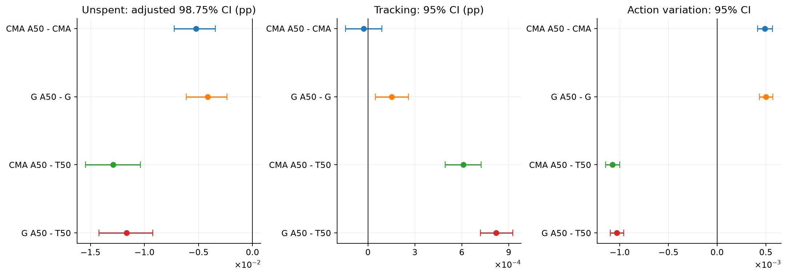
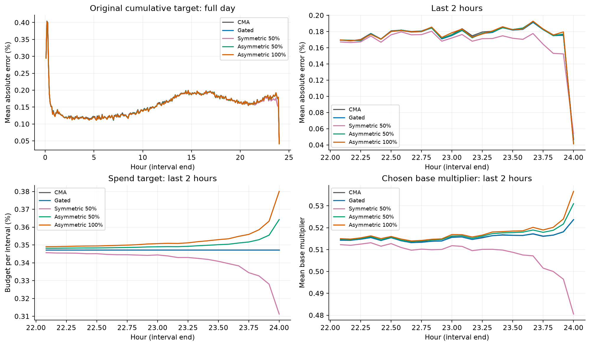
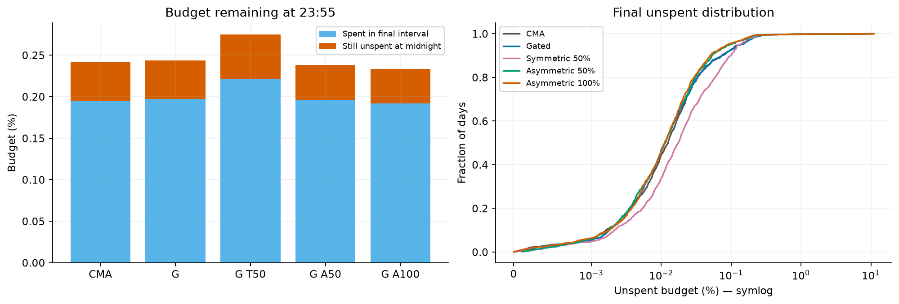
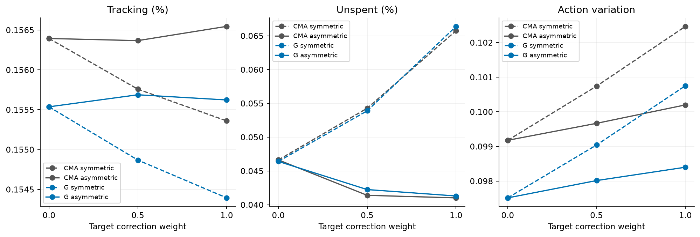

# 뒤처졌을 때만 지출 목표를 높이는 비대칭 보정

> **Ki 전용 공개 브랜치 안내**: 이 폴더의 기존 실험 결과·계획·프로토콜은 원본 그대로 보존했습니다. 공통 실행 코드 위치만 `pacing_ki_common`으로 분리했습니다. 현재 브랜치의 설치·검사·읽기 전용 재실행 방법과 원 실험 감사의 범위는 [공통 실행 안내](../pacing_ki_common/README.md)를 따릅니다.

2026-11-20. 시작 커밋 `cb8b0bb`. 앞선 [남은 시간 목표 실험](../pacing_deadline_pi/README.md)에서 제기한 비대칭 보정 가설을 새 합성 경매 1,000일에서 검증했다. [사전 계획](PLAN.md)에 10개 조건·주 비교·판정 기준을 고정했다.

**비대칭 보정은 앞선 대칭 보정의 미소진 악화를 해소했고, 원래 제어기보다도 미소진율을 낮췄다. 사전 지정 주 후보 G_A05는 CMA 대비 추종 오차 0.45%·미소진율 9.41%·승수 변동 1.17% 감소로 세 지표의 평균 기준을 모두 통과했다.** 최종 테스트는 사용하지 않았으므로 최종 확정 대신 후속 검증 후보로 보존한다.

## 새 1,000일의 결과

|정책|TE (%) ↓|UR (%) ↓|J (%) ↓|V ↓|
|---|---:|---:|---:|---:|
|CMA|0.156394|0.046637|0.203031|0.099178|
|CMA_T05|0.155758|0.054285|0.210043|0.100743|
|CMA_T1|0.155360|0.065758|0.221118|0.102468|
|CMA_A05|0.156367|0.041399|0.197766|0.099668|
|CMA_A1|0.156546|0.041022|0.197568|0.100201|
|G|0.155537|0.046416|0.201953|0.097516|
|G_T05|0.154868|0.053904|0.208772|0.099044|
|G_T1|0.154394|0.066397|0.220791|0.100754|
|G_A05|0.155688|0.042250|0.197938|0.098016|
|G_A1|0.155623|0.041301|0.196923|0.098401|

주 후보 G_A05의 상대 변화는 비교 기준에 따라 다르다.

| 비교 기준 | TE 상대 변화 | UR 상대 변화 | J 상대 변화 | V 상대 변화 |
|---|---:|---:|---:|---:|
| 기존 CMA | −0.452% | **−9.407%** | −2.509% | −1.172% |
| 기존 민감도 G | +0.097% | **−8.976%** | −1.988% | +0.513% |
| 대칭 보정 G_T05 | +0.529% | **−21.620%** | −5.190% | −1.038% |

비대칭 목표 자체가 세 지표를 모두 개선한 것은 아니다. G에 비대칭 보정을 추가하면 미소진율은 줄지만 추종 오차와 승수 변동 일부를 잃는다. 그 증가가 G의 기존 CMA 대비 이점을 전부 지우지는 않아, **결합된 G_A05는 CMA 대비 세 지표 평균이 모두 낮다.**

### 가설 판정과 불확실성

|주 비교|UR 차이 (%p)|98.75% 보정 구간 (%p)|판정|
|---|---:|---|---|
|CMA_A05 − CMA|-0.0052381|[-0.0072329, -0.0034334]|감소 방향 확인|
|G_A05 − G|-0.0041661|[-0.0061361, -0.0023664]|감소 방향 확인|
|CMA_A05 − CMA_T05|-0.0128858|[-0.0154744, -0.0103698]|감소 방향 확인|
|G_A05 − G_T05|-0.0116539|[-0.0142286, -0.0092174]|감소 방향 확인|

G_A05−CMA의 기술적 비교는 다음과 같다. 세 구간 모두 감소 방향이지만 이 표의 구간은 주 UR 네 비교와 달리 다중 비교를 보정하지 않은 95% 구간이다.

|지표|평균 차이|95% 기술적 구간|
|---|---:|---|
|TE (%p)|-0.0007064|[-0.0008765, -0.0005401]|
|UR (%p)|-0.0043871|[-0.0059703, -0.0028979]|
|V|-0.0011627|[-0.0012776, -0.0010469]|

G_A05의 UR은 G보다 489일 개선·498일 악화·13일 사실상 동일이었다. CMA와 비교하면 532일 개선·468일 악화였다. 평균 개선이 모든 날짜의 개선을 뜻하지 않으며, 날짜별 변화의 크기가 다르기 때문에 개선 일수만으로 평균 효과를 판단할 수 없다.

G_A05−G의 TE 차이는 **+0.0001509%p**, 95% 구간 `[+0.0000475, +0.0002584]%p`였고, V 차이는 **+0.0004998**, 95% 구간 `[+0.0004312, +0.0005702]`였다. 기존 민감도 제어기에 보정을 추가할 때 생기는 추종·변동 비용은 작지만 이번 자료에서 증가 방향으로 관측됐다.



UR 네 비교에는 98.75% 보정 구간, TE·V에는 95% 기술적 구간을 사용했다. 그림의 A50은 비대칭 50%, T50은 대칭 50%다. 음수는 개선 방향이다.

### 마감 직전 잔액의 변화

| 정책 | 23:55 잔액 (%) | 마지막 5분 지출 (%) | 최종 UR (%) |
|---|---:|---:|---:|
| CMA | 0.241759 | 0.195122 | 0.046637 |
| G | 0.243957 | 0.197540 | 0.046416 |
| G_T05 | 0.275262 | 0.221358 | 0.053904 |
| G_A05 | 0.238379 | 0.196129 | 0.042250 |
| G_A1 | 0.233310 | 0.192009 | 0.041301 |

G_A05는 G보다 마지막 구간에 넘긴 잔액이 **0.005577%p 작았고**, 마지막 구간 지출도 **0.001411%p 작았다**. 그 결과 최종 잔액은 **0.004166%p 줄었다**. 마지막 5분에 더 지출해 소진을 개선했다는 해석은 맞지 않는다. 마감 직전까지 더 지출한 경로가 관측됐다.

G_T05에서 관측됐던 목표 하향은 전체 구간의 **56.15%**, 같은 상태에서 고정 목표 대비 기본 승수 하향은 **7.13%**였다. G_A05에서는 두 하향 빈도가 모두 **0%**다. 비대칭 목표 상향은 **43.20%** 구간에서 발생하지만, 0.01 간격 승수 선택 때문에 실제 기본 승수 상향은 **2.51%**였다. 마지막 2시간에는 기본 승수 상향이 **7.28%** 구간에서 발생했다. 이 수치는 각 정책의 같은 상태에서 고정 목표를 선택했을 때와 비교한 값이다.

G_A05의 평균 누적 앞섬은 G보다 **0.000196%p 증가**했고 평균 누적 부족은 **0.000045%p 감소**했다. 절대 추종 오차는 두 값의 합이므로 평균 TE가 조금 증가한다. 목표보다 약간 앞서 지출하는 여유를 유지해 미소진을 줄인다는 가설과 일치하지만, 평균 경로만으로 모든 날짜의 작동 원인을 설명할 수는 없다.



시간은 각 구간의 종료 시각이다. 지출 목표와 기본 승수는 해당 구간 시작 때 계산한 값이며 추종 오차는 구간 종료 후 값이다. 누적 평가 목표는 전 조건에서 그대로다.



왼쪽 막대의 전체 높이는 23:55 잔액이며, 마지막 구간 지출과 최종 미소진으로 나눴다. 오른쪽은 전체 1,000일 분포로 큰 잔액 사례까지 표시했다.

### 보정 강도와 적용 판단

G_A1은 G 대비 UR 평균이 **11.02% 감소**, TE **0.055% 증가**, V **0.907% 증가**했다. G_A05보다 UR 평균은 더 낮지만 V는 더 높다. 사전 지정한 주 후보를 확인 결과로 바꾸지 않았다. CMA에 비대칭 50%를 직접 붙인 CMA_A05도 UR은 **11.23% 감소**했지만 V가 **0.494% 증가**해 세 지표 동시 기준은 통과하지 못한다.



앞 500일과 뒤 500일에서 G_A05의 CMA 대비 UR 감소는 각각 **7.76%·13.33%**, TE 감소는 **0.50%·0.40%**, V 감소는 **1.18%·1.16%**였다. G 대비 UR 감소도 각각 **8.76%·9.52%**로 방향이 같았다. 분할 결과는 설명용 진단이고 독립적인 추가 검증 두 번을 수행한 것으로 세지 않는다.

**판정:** 대칭 보정의 앞섬 억제를 제거한다는 가설은 이번 합성 환경에서 지지됐다. G_A05를 후속 검증 대상으로 승격하되 최종 테스트나 실제 경매 성능이 확인된 모델로 취급하지 않는다. CMA 가중치를 그대로 이용하므로 이번 개선은 계수망 재학습의 성과가 아니라 기존 민감도 제어와 지출 목표 보정의 결합 결과다.

## 실험한 변경

N=288개의 5분 구간, 구간 시작 시점 t=0..287, 예산 B, 누적 지출 S에 대해 원래 지출 목표는 매 구간 예산의 1/N이다. 남은 예산과 시간을 반영한 대칭 보정과 이번 비대칭 보정은 다음과 같다.

```text
q_need = max(0, 1 - S/B) / (N - t)
q_symmetric = (1 - lambda)/N + lambda*q_need
q_asymmetric = max(1/N, q_symmetric)
```

예산이 정상 범위 안에 있을 때 누적 오차 e=t/N−S/B를 쓰면 `q_asymmetric=1/N+lambda*max(0,e)/(N-t)`다. 뒤처졌을 때는 대칭 방식과 같은 목표를 사용한다. 앞섰을 때는 기존 고정 목표보다 낮추지 않는다. **이 하한은 기본 승수가 따라갈 지출 목표의 하한**이다. 최종 입찰 승수에는 PI 보정·상한·예산 검사가 계속 적용된다.

B 선형 예측기로 0..1의 101개 기본 승수 후보를 평가하고 목표 지출률에 가장 가까운 후보를 선택한다. 처음 구간의 초기 승수는 유지한다. B의 양의 기울기 때문에 같은 상태에서 비대칭 기본 승수는 고정 목표의 기본 승수보다 낮아지지 않지만, 폐루프 경로가 달라진 두 정책의 실제 입찰 승수가 매번 같은 순서를 갖는 것은 아니다.

| 기반 | 기존 | 대칭 50% | 대칭 100% | 비대칭 50% | 비대칭 100% |
|---|---|---|---|---|---|
| CMA E2 | CMA | CMA_T05 | CMA_T1 | CMA_A05 | CMA_A1 |
| 기존 민감도 G | G | G_T05 | G_T1 | **G_A05: 주 후보** | G_A1 |

G는 기존 `gated_ratio_p0.25_m0.75`다. B 예측기, CMA 가중치·계수 산출 함수, G의 EMA·중심값·배율 조건은 그대로 사용했다. Ki 위험 복원은 모든 조건에서 끄고 비대칭 목표의 효과만 분리했다. 기존 가중 적분값을 재배율하지 않으며 anti-windup, Ki 상한 6000, 최종 승수 상한 1, 경매별 예산 검사를 유지했다. 기본 승수와 이후 관측이 달라져 실제 Kp·Ki 출력 경로는 달라질 수 있다.

## 자료와 판정

- 새 확인 1,000일: **560000–560999**. 구현 검사: 630000–630004 중 별도 사례.
- 기존 실험 프로토콜의 날짜와 분리했으며 최종 테스트 **200000–200499의 500일은 미사용**이다.
- 같은 날짜의 경매 테이프·예산·누적 목표 경로를 모든 정책에 공통 적용했다. 제어기에는 현재 및 미래 경매를 전달하지 않았다.
- 학습·보정·후보 선택을 추가하지 않았다. 50% 주 후보와 100% 진단 조건을 결과에 따라 교체하지 않는다.

TE는 원래 누적 목표에 대한 평균 절대 오차/예산, UR은 최종 잔액/예산, J=TE+UR, V는 인접 승수 평균 절대 변화다. 낮을수록 좋다. TE·UR·J의 표시는 %, 차이는 %p이며 상대 변화율과 구별한다.

주 지표 UR의 비교 네 개는 CMA_A05−CMA, G_A05−G, CMA_A05−CMA_T05, G_A05−G_T05다. 날짜 단위 paired bootstrap 20,000회(seed 20261123), Bonferroni **98.75% 구간**을 적용했다. 다른 지표·진단 비교는 다중 비교를 보정하지 않은 **95% 기술적 구간**이다. 1,000일로 작은 차이를 반드시 판별할 수 있는 것은 아니다.

대칭 보정의 악화를 회복하는 것과 원래 부모를 개선하는 것을 구분한다. 주 후보 G_A05의 CMA 대비 TE·UR 표본 평균 비증가와 V 감소를 동시에 요구한다. 이는 통계적 비열등성 입증과 별개이며 허용 손실을 사후 도입하지 않는다. 앞/뒤 500일은 안정성 진단이고 새 후보를 고르는 자료가 아니다.

## 재현과 한계

9개 구현 검사를 모두 통과했다. 기존 여섯 조건의 원본 정책 재현, 10개 조건의 두 구현 일치, 같은 상태의 목표·기본 승수 하한, 부족·정상·앞섬·마감·소진 완료 경계, 가중 적분 보존, 위험 복원 비사용, 미래 정보 독립성, 기존 평가 목표·예산 제한·봉인 날짜 차단을 확인했다.

가속 평가 **10,000회**와 원본 Python 시뮬레이터 재실행 **10,000회**, 본 실행 총 **20,000회**다. 6개 성능 지표의 최대 절대 차이는 **5.41×10⁻¹⁶**, 진단값 최대 차이는 **2.50×10⁻¹²**였다. 평가·재검산·bootstrap은 약 **542.2초** 걸렸다. 소스·사전 계획·부모 파일 해시, 동결 시점, 날짜별 공통 테이프와 이전 7개 프로토콜의 날짜 분리를 확인했다. 표·그림은 저장된 결과만 사용했다.

```powershell
.\.venv-nsga2\Scripts\python.exe -m unittest discover -s research_report/pacing_asymmetric_pi/code -p 'test_*.py' -v
.\.venv-nsga2\Scripts\python.exe research_report/pacing_asymmetric_pi/code/experiment.py all
.\.venv-nsga2\Scripts\python.exe research_report/pacing_asymmetric_pi/code/report.py
.\.venv-nsga2\Scripts\python.exe research_report/pacing_asymmetric_pi/code/experiment.py audit
```

완료된 단계는 다시 호출해도 재평가하지 않는다. 재현·감사는 이 실험 커밋의 작업 복사본에서 수행한다. 독립 재실행은 해당 복사본의 새 결과 디렉터리를 사용한다. 이후 실험 프로토콜이 추가된 작업 트리에서는 날짜 분리 검사 대상도 달라지므로 원래 커밋으로 돌아와 확인해야 한다. [기존 환경 lock](../pacing_ki_common/requirements.txt)을 사용한다. 코드·결과·그림은 로컬 브랜치에만 보존한다.

실제 시장 자료로 교정하지 않은 하루 단위 합성 first-price 환경의 결과다. 앞섬 억제를 제거하는 한 가지 고정 규칙의 검증이며, 모든 비대칭 제어의 가능성을 판정하지 않는다. B 예측기는 재학습하지 않았고, 연속 목표율과 0.01 간격 승수 후보 사이에 양자화가 남는다. 입찰 승수가 높아져도 결제액·낙찰 집합·예산 잔액이 함께 달라지므로 최종 미소진 감소가 보장되지는 않는다.

주요 근거:

- [사전 계획](PLAN.md), [동결 프로토콜](results/protocol.json).
- [전체 결과표](results/report_tables.md), [일별 결과](results/fresh_daily.csv), [짝지은 차이](results/fresh_paired.csv).
- [기전 요약](results/diagnostics_summary.csv), [기전 차이](results/diagnostics_paired.csv), [시간대별 경로](results/time_profiles.csv).
- [앞/뒤 500일](results/half_sample_summary.csv), [판정](results/conclusion.json).
- [구현 검사](results/implementation_checks.json), [원본 재검산](results/evaluator_audit.csv), [실행 감사](results/audit.json).
- [제어기](code/controller.py), [가속 평가기](code/fast_asymmetric.py), [실험 절차](code/experiment.py).
