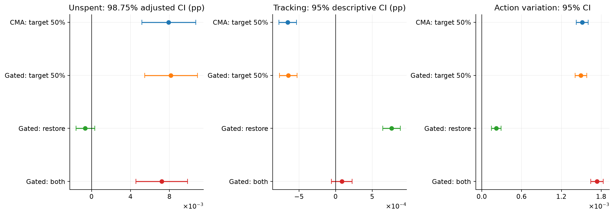
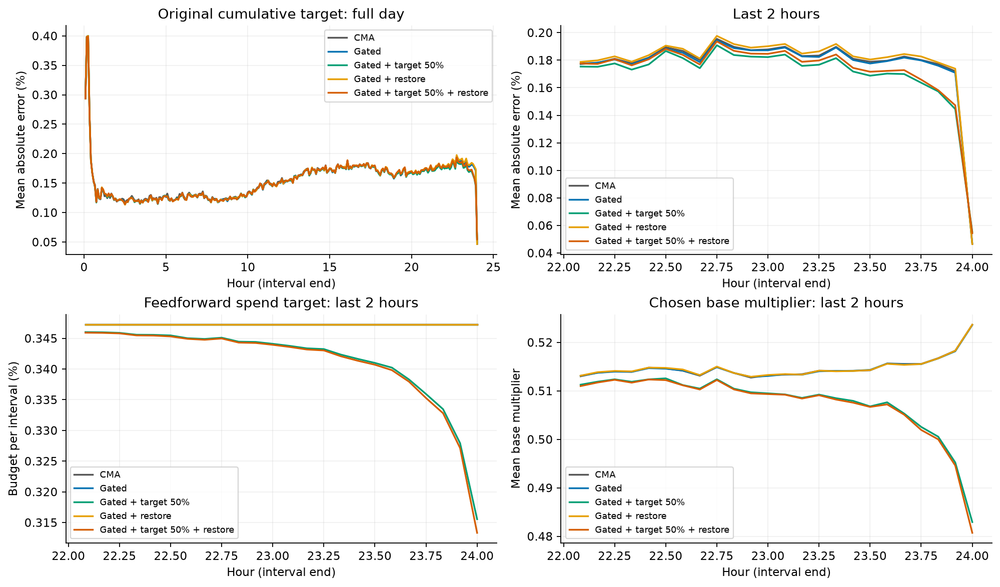
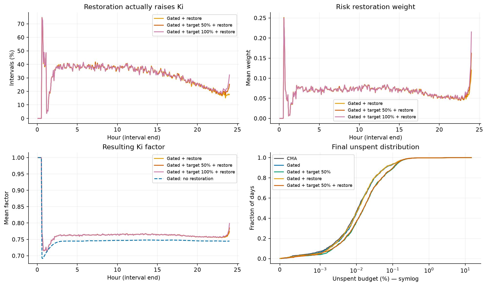
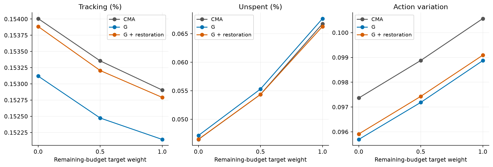

# 남은 시간 기반 지출 목표와 위험 조건부 Ki 복원 실험

> **Ki 전용 공개 브랜치 안내**: 이 폴더의 기존 실험 결과·계획·프로토콜은 원본 그대로 보존했습니다. 공통 실행 코드 위치만 `pacing_ki_common`으로 분리했습니다. 현재 브랜치의 설치·검사·읽기 전용 재실행 방법과 원 실험 감사의 범위는 [공통 실행 안내](../pacing_ki_common/README.md)를 따릅니다.

2026-11-20, 시작 커밋 `45d5da0`. 사용자 요청에 따라 두 변경을 각각 및 결합해 검증했다. [사전 계획](PLAN.md)에 9개 조건과 판정 기준을 고정하고 이전 실험과 겹치지 않는 1,000일을 평가했다. 기존 CMA E2와 신뢰도 민감도 후보 G는 그대로 비교했다.

**남은 예산/시간 목표를 현재 PI 구조에 직접 적용하면 추종 오차는 줄었지만 미소진율은 더 높아졌다. 위험 조건부 Ki 복원은 기존 민감도 후보의 미소진율 평균을 낮췄으나 추종 오차·승수 변동 일부를 되돌렸다.** 결합 조건도 개선 기준을 통과하지 못해 CMA를 유지한다. 여기서 실패한 것은 사전 고정한 목표 혼합·복원 규칙이며, 남은 시간이나 위험을 이용하는 모든 제어 방식이 불가능하다는 뜻은 아니다.

## 새 1,000일의 결과

| 정책 | TE (%) ↓ | UR (%) ↓ | J (%) ↓ | V ↓ |
|---|---:|---:|---:|---:|
| CMA | 0.154007 | 0.046467 | 0.200474 | 0.097365 |
| CMA + 목표 50% | 0.153355 | 0.054361 | 0.207715 | 0.098879 |
| CMA + 목표 100% | 0.152905 | 0.066737 | 0.219642 | 0.100567 |
| 기존 민감도 G | 0.153120 | 0.047159 | 0.200279 | 0.095694 |
| G + 목표 50% | 0.152474 | 0.055303 | 0.207776 | 0.097187 |
| G + 목표 100% | 0.152143 | 0.067656 | 0.219799 | 0.098873 |
| G + 위험 복원 | 0.153885 | 0.046498 | 0.200383 | 0.095914 |
| G + 목표 50% + 위험 복원 — 주 후보 | 0.153206 | 0.054352 | 0.207558 | 0.097432 |
| G + 목표 100% + 위험 복원 | 0.152792 | 0.066272 | 0.219063 | 0.099091 |

| 비교 | TE 상대 변화 | UR 상대 변화 | V 상대 변화 |
|---|---:|---:|---:|
| CMA + 목표 50% / CMA | −0.423% | **+16.988%** | +1.556% |
| G + 목표 50% / G | −0.422% | **+17.268%** | +1.560% |
| G + 목표 100% / G | −0.638% | **+43.463%** | +3.322% |
| G + 위험 복원 / G | **+0.499%** | **−1.402%** | +0.229% |
| G + 목표 50% + 위험 복원 / G | +0.056% | **+15.252%** | +1.816% |

단독 효과를 볼 때는 변경 전의 같은 부모와 비교해야 한다. 예를 들어 G_R의 CMA 대비 TE는 낮지만, G에 복원을 추가한 효과만 보면 TE가 높아졌다. 낮은 TE를 복원 자체의 개선으로 해석하지 않는다.

주 지표 UR의 사전 지정 네 비교는 다음과 같다. 음수는 개선이며 단위는 %p다.

| 주 비교 | UR 평균 차이 | 98.75% 보정 구간 | 판정 |
|---|---:|---|---|
| CMA + 목표 50% − CMA | +0.0078938 | [+0.0051778, +0.0106900] | 악화 방향 확인 |
| G + 목표 50% − G | +0.0081434 | [+0.0054716, +0.0108744] | 악화 방향 확인 |
| G + 위험 복원 − G | −0.0006613 | [−0.0016027, +0.0003182] | 평균 감소, 개선은 불확실 |
| G + 목표 50% + 위험 복원 − G | +0.0071926 | [+0.0045536, +0.0098596] | 악화 방향 확인 |



UR에는 네 비교에 대한 98.75% 구간, TE·V에는 95% 기술적 구간을 표시했다. 모든 비교의 기준은 변경 전의 같은 부모(CMA 또는 G)다.

### 남은 시간 목표: 추종 개선과 함께 마감 잔액이 증가

남은 시간 목표의 미소진 증가 방향은 CMA와 G 모두에서 나타났다. G에서 목표 비중을 0.5에서 1로 높이면 UR 증가 폭도 17.27%에서 43.46%로 커졌다. 주 후보의 좋지 않은 결과를 보고 비중이나 후보를 다시 선택하지 않았다.

최종 구간 직전 잔액과 그 구간의 실제 지출을 분리하면 다음과 같다. 모두 전체 예산 대비 %다.

| 정책 | 23:55 잔액 | 마지막 5분 지출 | 24:00 잔액 = UR |
|---|---:|---:|---:|
| G | 0.250156 | 0.202997 | 0.047159 |
| G + 목표 50% | 0.283867 | 0.228564 | 0.055303 |
| G + 위험 복원 | 0.246256 | 0.199758 | 0.046498 |
| G + 목표 50% + 위험 복원 | 0.279420 | 0.225068 | 0.054352 |

G_T05의 마지막 지출은 G보다 **0.025568%p 늘었지만**, 마지막 구간으로 넘긴 잔액이 **0.033711%p 늘어** 최종 잔액이 증가했다. 따라서 마지막 5분에 덜 썼기 때문에 실패했다는 설명은 맞지 않는다.

G의 23:55 평균 누적 오차는 **−0.097066%**로 목표보다 앞서 있었고 G_T05에서는 **−0.063355%**로 앞섬이 작아졌다. G_T05의 마지막 구간 평균 목표 지출률은 **0.315545%**, 기존 G의 고정 목표는 **0.347222%**였다. 마지막 구간의 평균 기본 승수도 **0.52358 → 0.48293**으로 낮았다.

**관측을 바탕으로 한 해석:** 목표보다 앞선 상태에서 필요 지출률을 낮추는 반응이 추종 오차를 줄이는 동시에 마감 전 소진 여유를 줄인 것으로 보인다. 불확실한 마지막 경매의 평균 목표를 잔액에 맞추는 것만으로 실제 소진이 보장되지는 않는다. 이 설명은 평균 경로와 잔액 분해에 기반한 추론이며, 앞섬 억제만 따로 제거한 인과 실험은 이번에 하지 않았다.

수식에서도 기존 PI와의 중복 가능성을 볼 수 있다. 예산 정규화 누적 오차를 e=t/N−S/B라고 쓰면 `q_target=1/N+lambda*e/(N-t)`다. B의 승수 기울기 g가 약 0.010896이므로, 격자·출력 제한을 무시한 같은 상태의 연속 근사에서는 `기본 승수 변화 ≈ lambda*e/[g*(N-t)]`다. 즉 남은 시간이 줄수록 강해지는 추가 비례 보정의 형태다. 마지막 구간에는 이 추가 계수가 lambda=0.5에서 약 **45.9**, lambda=1에서 **91.8**까지 커진다. 이 근사는 전체 폐루프 이득을 뜻하지 않지만, 이미 있는 PI 보정과 상호작용하고 목표보다 앞선 경우에도 더 강하게 지출을 줄일 수 있음을 보여준다. [계산 근거](results/control_geometry.json)



그림의 시간은 각 5분 구간 종료 시각이다. 추종 오차는 모든 조건에 공통인 원래 누적 목표로 계산했다.

### 위험 조건부 Ki 복원: 소진과 추종 사이의 절충

G_R은 전체 구간의 **31.96%**, 마지막 2시간 구간의 **18.06%**에서 실제로 Ki를 올렸다. 전체 평균 factor는 **0.74933 → 0.76551**, 평균 Ki는 **940.28 → 963.76**이었다. CMA 평균 Ki는 1255.07이다. 연속 가중 복원이므로 가동 구간 전체에서 CMA 수준으로 완전히 복원되는 것은 아니다.

G_R의 UR 평균은 G보다 **1.40% 감소**했지만 TE는 **0.50%**, V는 **0.23% 증가**했다. J도 **0.052% 증가**했다. 마지막 구간 직전 잔액과 최종 잔액의 표본 평균은 줄었지만, 전체 경로의 부드러운 추종 효과 일부를 잃었다.

UR은 G보다 **763일 개선·237일 악화**했다. 개선된 날짜가 더 많아도 차이의 크기가 다르므로 평균 개선의 확실성이 보장되지는 않는다. 일반 95% UR 구간도 `[−0.0014123, +0.0000972]%p`로 0을 포함한다. 반면 TE 차이 **+0.0007646%p**의 95% 구간 `[+0.0006456, +0.0008850]%p`와 V 차이 **+0.0002195**의 구간 `[+0.0001476, +0.0002921]`은 모두 증가 방향이다.

CMA와 비교하면 G_R의 TE는 **−0.079%**, V는 **−1.490%**, UR은 **+0.067%**다. UR 절대 차이는 **+0.0000313%p**로 작지만 사전 지정한 엄격한 평균 비악화 기준은 통과하지 못한다. 이 미세한 평균 차이만으로 성능 악화를 확정하지 않는다.

G_R−CMA의 UR 95% 구간은 **[−0.0006653, +0.0007289]%p**, 단측 95% 상한은 **+0.0006214%p**다. 0 차이를 기준으로 한 비열등성을 입증하지 못한다. V 감소는 분명하지만 TE 차이의 95% 구간도 0을 포함한다. 따라서 이 후보를 CMA보다 모든 면에서 좋아진 제어기로 해석하지 않는다.



위험 점수는 최근 지출 속도와 필요 지출률의 차이에 대한 휴리스틱이다. 지출 목표에 남은 시간을 반영하지 않은 G_R도 위험 계산에는 남은 시간을 사용한다. 신호의 작동 빈도와 예산 소진 실패 확률은 같은 값이 아니다.

### 결합 조건과 판단

G_T05_R은 G 대비 UR 평균이 15.25% 높아졌다. 복원을 추가하면 G_T05보다 UR은 낮아지지만, 목표 변경에서 생긴 증가를 상쇄하지 못했다. CMA 대비 주 후보의 TE는 **−0.520%**, UR은 **+16.970%**, V는 **+0.069%**여서 교체 기준을 충족하지 못한다. lambda=1 결합에서도 CMA 대비 UR은 **+42.622%**였다.

이번 8개 변경·비교 후보 모두 CMA보다 UR 평균이 높았다. 사전 지정 주 후보를 교체하지 않고 CMA를 유지한다. 위험 복원 단독은 미소진 감소 방향을 보였지만 추종·변동을 함께 개선한 해결책으로 채택하지 않는다.

두 변경의 UR 상호작용 `(G_T05_R−G_T05)−(G_R−G)`은 **−0.0002895%p**, 95% 구간 `[−0.0014485, +0.0008372]%p`로 0을 포함한다. 결합 자체의 특별한 추가 이득을 확인하지 못했다. 앞/뒤 500일에서도 목표 50% 적용의 UR 증가와 위험 복원 단독의 G 대비 UR 감소 방향은 같았다. 다만 G_R의 CMA 대비 UR 평균 차이는 앞 500일 **+0.0000835%p**, 뒤 500일 **−0.0000209%p**로 부호가 바뀌었다. 이 분할 결과는 안정성 진단이며 새 선택 자료로 사용하지 않았다.



후속으로 검증할 가치가 있는 가설은 **뒤처졌을 때만 필요 지출률을 높이고, 앞섰을 때 고정 목표보다 낮추지는 않는 비대칭 보정**이다. 마감 직전 불확실성에 대한 여유를 따로 설계하는 것도 가능하다. 둘 다 이번 결과로 떠오른 미검증 가설이며, 이번 1,000일에서 새 설정을 선택하거나 추가 성공 결과로 처리하지 않았다.

## 구현한 두 변경

### 1. 기본 승수의 지출 목표에 남은 시간 반영

총 구간 수 N=288, 현재 구간 t=0..287, 예산 B, 누적 지출 S일 때 다음 5분의 예산 정규화 필요 지출률은 다음과 같다.

```text
q_need = max(0, 1 - S/B) / (N - t)
q_target = (1 - lambda) / N + lambda * q_need
```

기존 B 예측기로 승수 0..1의 101개 후보를 예측하고 q_target에 가장 가까운 후보를 기본 승수로 선택한다. lambda=0은 기존 방식, 0.5는 절반 반영한 주 조건, 1은 완전히 반영한 진단 조건이다. 같은 부족액이라도 남은 시간이 짧으면 더 큰 보정이 생긴다. 목표보다 앞선 경우에는 q_need가 기존 고정 지출률보다 낮아진다.

첫 구간의 초기 승수는 기존 값으로 유지한다. 평가에 사용하는 누적 목표 t/N과 PI 누적 오차는 그대로다. 기준 경로를 바꿔 추종 오차를 낮추는 실험이 아니다. 기본 승수 변경으로 계수망 입력과 이후 관측이 달라지므로 실제 Kp·Ki 경로가 고정되는 것은 아니다.

남은 예산/시간 기반 지출률은 [AAMAS 2023 논문 Algorithm 1](https://www.ifaamas.org/Proceedings/aamas2023/pdfs/p2709.pdf)에서도 사용한다. 이번에는 이 목표율을 기존 예측기+PI 구조에 적용했으며 논문의 전체 입찰 갱신 알고리즘을 재현한 것은 아니다.

### 2. 소진 부족 위험에 따른 Ki 감소 제한

최근 12구간 중 예산 제약으로 잘린 지출과 action≤0.0001을 제외한 유효 관측이 6개 이상일 때, 해당 구간의 평균 정규화 지출을 q_hat으로 계산한다. 현재 누적 목표에 뒤처져 있고 q_hat<q_need일 때만 복원한다.

```text
w = clip((q_need - q_hat) / (0.25 * q_need), 0, 1)
factor_new = factor_old + w * max(0, 1 - factor_old)
Ki_new = clip(Ki_CMA(current_state) * factor_new, 0, 6000)
```

나머지 상태에서는 w=0이다. 기존 factor가 1 이상이면 바꾸지 않는다. 관측 부족 시 원래 factor=1 fallback을 유지한다. 필요 지출률보다 최근 속도가 25% 이상 낮으면 완전히 복원하고, 그 사이에서는 연속적으로 복원한다. 최근 속도가 남은 기간에도 유지된다는 가정의 휴리스틱이며, 실제 실패 확률이나 미래 경매량 예측이 아니다.

지출 목표 변경과 같은 부족분을 PI가 중복 보정할 가능성을 허용한 상태에서 단독·결합 조건을 비교했다. 이미 쌓인 가중 적분값은 재배율하지 않고 이후 누적분의 Ki만 바꾼다. B 예측기, CMA 가중치·Kp 산출 함수, 입찰 승수 상한 1, Ki 상한 6000, 기존 anti-windup과 경매별 예산 검사는 공통이다. 시간대만으로 제어기를 전환하지 않는다.

## 고정한 조건과 자료

| 정책 | 기반 | 남은 예산 목표 비중 | 위험 조건부 Ki 복원 |
|---|---|---:|---|
| CMA | 기존 CMA E2 | 0 | 없음 |
| CMA_T05 | CMA E2 | 0.5 | 없음 |
| CMA_T1 | CMA E2 | 1 | 없음 |
| G | 기존 신뢰도 민감도 후보 | 0 | 없음 |
| G_T05 | G | 0.5 | 없음 |
| G_T1 | G | 1 | 없음 |
| G_R | G | 0 | 적용 |
| G_T05_R | G | 0.5 | 적용 — 사전 지정 결합 주 후보 |
| G_T1_R | G | 1 | 적용 — 진단 조건 |

G는 앞선 `gated_ratio_p0.25_m0.75`이며, EMA 초기값·중심값·p는 변경하지 않았다. 학습·보정·후보 선택 단계 없이 모든 조건을 확인 전에 동결했다.

- 새 확인 1,000일: **550000–550999**.
- 구현 검사: 620000–620004 중 별도 사례 사용.
- 기존 확인 날짜는 재사용하지 않으며 최종 테스트 **200000–200499의 500일은 계속 미사용**이다.
- 같은 날짜의 경매 테이프·예산·누적 목표 경로를 모든 정책에 공통 적용했다. 현재 및 미래 경매 정보는 제어기에 전달하지 않았다.

TE는 평균 절대 누적 지출 격차/예산, UR은 최종 미소진액/예산, J=TE+UR, V는 인접 입찰 승수의 평균 절대 변화다. 낮을수록 좋다. TE·UR·J의 표시는 %, 차이는 %p이며 상대 변화율과 구별한다.

주 지표는 UR이다. CMA_T05−CMA, G_T05−G, G_R−G, G_T05_R−G 네 비교에 날짜 단위 paired bootstrap 20,000회(seed 20261122)와 Bonferroni **98.75% 구간**을 적용했다. 다른 지표와 진단 조건은 다중 비교를 보정하지 않은 **95% 기술적 구간**으로 해석한다. 1,000일이 작은 차이를 판별할 검정력을 보장하지는 않는다.

결합 주 후보 G_T05_R의 CMA 대비 TE·UR 평균 비악화와 V 감소를 함께 판정한다. 평균 기준 통과와 통계적 비열등성을 구별하고 허용 손실을 사후 도입하지 않는다. lambda=1 조건이 더 좋아도 확인 결과로 주 후보를 바꾸지 않는다. 앞/뒤 500일의 결과와 두 변경의 상호작용도 설명용으로 기록했다.

## 재현과 한계

10개 구현 검사를 통과했다. 기존 CMA·G 행동의 재현, 9개 조건의 두 구현 일치, 지출 목표의 경계·정상·부족·초과 상태, 위험 신호의 조건과 단조성, 복원이 factor를 낮추지 않음, 예산·행동·Ki 제한, 예산에 잘린 관측 제외, 적분값 보존, 미래 경매 독립성, 원래 평가 목표 및 봉인 날짜 차단을 확인했다.

가속 평가 **9,000회**와 원본 Python 시뮬레이터 재실행 **9,000회**, 본 실행 총 **18,000회**다. 검사와 컴파일 준비는 별도다. 6개 성능 지표의 최대 절대 차이는 **4.72×10⁻¹⁶ 미만**, 진단값의 최대 차이는 **2.28×10⁻¹² 미만**이었다. 평가·재검산·bootstrap에 약 **594.1초**가 걸렸다. 표·그림은 저장된 결과만 사용했다. 소스·계획·부모 파일 해시, 동결 시점, 날짜별 테이프 일치와 기존 여섯 실험 프로토콜에 대한 날짜 분리를 확인했다.

```powershell
.\outputs\ki-venv\Scripts\python.exe -m unittest discover -s research_report/pacing_deadline_pi/code -p 'test_*.py' -v
.\outputs\ki-venv\Scripts\python.exe research_report/pacing_ki_common/code/verify_export.py
.\outputs\ki-venv\Scripts\python.exe research_report/pacing_ki_common/code/replay.py --bundle pacing_deadline_pi --days 2
```

완료 단계는 다시 호출해도 재평가하지 않는다. 독립 재현은 별도 작업 복사본의 새 결과 디렉터리에서 수행한다. [기존 환경 lock](../pacing_ki_common/requirements.txt)을 사용한다. 결과는 로컬 브랜치에만 보존한다.

실제 시장 자료로 교정하지 않은 하루 단위 합성 first-price 환경의 결과다. 최근 지출 속도 추정은 계절성·미래 경매량을 예측하지 않고, 현재 B 모델은 변경한 목표율에 대해 재학습하지 않았다. 후보 범위를 벗어난 목표도 가장 가까운 승수를 선택한다. 실행 주기와 승수 상한, 잔액보다 큰 결제액을 건너뛰는 경매 규칙은 그대로다. 이 조건들의 영향까지 해결한 실험은 아니다.

주요 근거:

- [사전 계획](PLAN.md), [protocol.json](results/protocol.json): 고정한 조건·소스·부모 파일 해시.
- [전체 결과표](results/report_tables.md), [일별 결과](results/fresh_daily.csv), [짝지은 차이](results/fresh_paired.csv).
- [기전 진단](results/diagnostics_summary.csv), [마감 지표 차이](results/diagnostics_paired.csv), [시간대별 경로](results/time_profiles.csv).
- [앞/뒤 500일](results/half_sample_summary.csv), [상호작용](results/interaction.csv), [판정](results/conclusion.json).
- [구현 검사](results/implementation_checks.json), [원본 재검산](results/evaluator_audit.csv), [실행 감사](results/audit.json).
- [제어기](code/controller.py), [가속 평가기](code/fast_deadline.py), [실험 절차](code/experiment.py).
