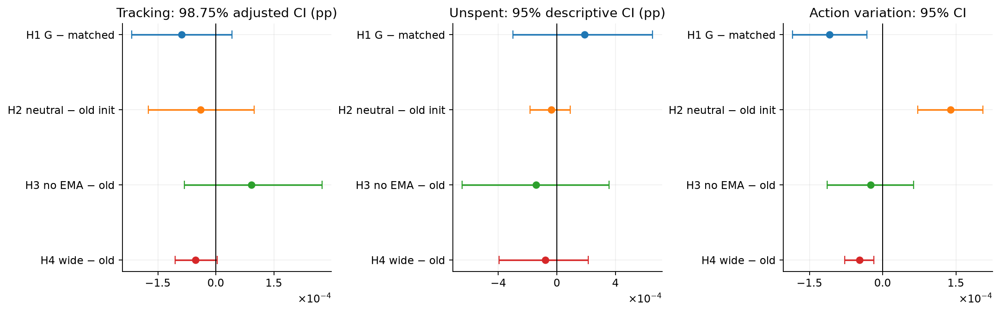
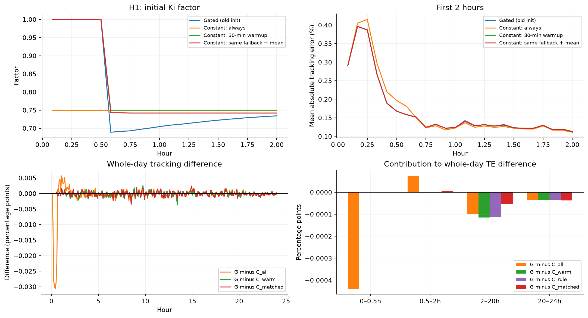
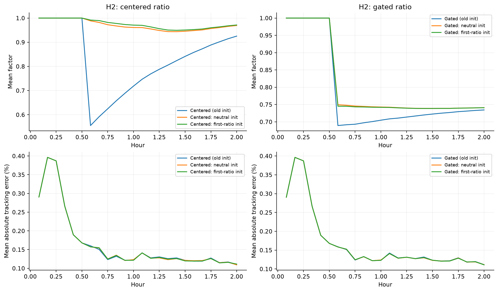
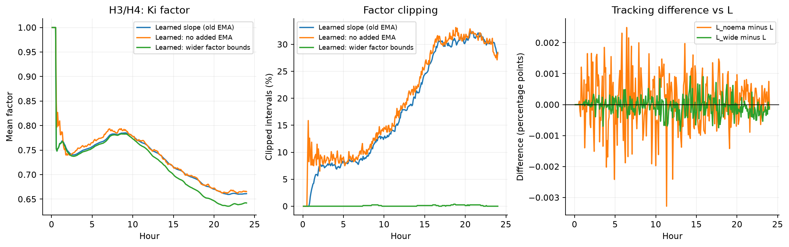

# 민감도 기반 Ki: 초기 동작·EMA·배율 제한의 후속 가설 검증

> **Ki 전용 공개 브랜치 안내**: 이 폴더의 기존 실험 결과·계획·프로토콜은 원본 그대로 보존했습니다. 공통 실행 코드 위치만 `pacing_ki_common`으로 분리했습니다. 현재 브랜치의 설치·검사·읽기 전용 재실행 방법과 원 실험 감사의 범위는 [공통 실행 안내](../pacing_ki_common/README.md)를 따릅니다.

2026-11-19. 시작 커밋 `5156715`. 앞선 연구에서 남긴 가설을 [평가 전 계획](PLAN.md)에 고정하고, 새로운 보정 80일과 확인 800일에서 검증했다. 이전 400일은 가설 생성에만 사용했다. NSGA-II는 종료 상태이며, CMA와 기울기 모델을 재학습하지 않았다.

**이전 적응 후보의 상수 대비 추종 이득에는 초기 동작 차이가 크게 섞여 있었다.** 이를 맞추고 평균 배율까지 보정하면 추가 추종 이득은 불확실했다. EMA 초기값과 배율 제한의 문제는 실제로 완화했지만, 어느 후보도 CMA 대비 미소진율 평균을 유지하지 못했다. **CMA를 유지하며 이번 조건을 개선 모델로 채택하지 않는다.** 이는 효과가 전혀 없다는 결론이 아니라, 확인한 범위에서 교체 근거가 부족하다는 판단이다.

## 핵심 결과

| 가설 | 새 800일에서 관측한 결과 | 판단 |
|---|---|---|
| H1 적응 고유의 이득 | G의 상수 대비 TE 이득이 초기 동작·평균 배율을 맞추면서 0.000499%p → 0.000088%p로 축소. 남은 차이의 98.75% 구간은 0 포함 | 주 가설 미확인. 초기 동작 차이의 중요성은 확인 |
| H2 EMA 초기값 | R의 최초 적응 평균 factor 0.5535 → 0.9881. 하루 TE·UR 차이는 불확실하며 V는 증가 | 초기 배율 급락은 완화, 성능 개선 근거 부족 |
| H3 추가 EMA 제거 | L 대비 TE 평균 증가, UR 평균 감소. 두 차이 모두 불확실 | EMA 지연이 주된 실패 원인이라는 가설 미확인 |
| H4 배율 제한 완화 | 잘림 18.14% → 0.077%. TE·UR·V 평균 감소, TE는 다중 비교 보정 후 0 포함 | 제한 문제는 완화, CMA 교체 근거 부족 |



음수는 개선이다. TE에는 사전 고정한 네 비교에 대한 98.75% 구간, UR·V에는 다중 비교를 보정하지 않은 95% 기술적 구간을 사용했다. 네 주 비교의 TE 구간은 모두 0을 포함한다.

### H1 — 초기 동작을 맞추면 적응의 추가 가치가 얼마나 남는가

| G의 비교 대상 | G − 대조군 TE (%p) | 95% 기술적 구간 |
|---|---:|---|
| 처음부터 상수: C_all | −0.0004989 | [−0.0006224, −0.0003793] |
| 첫 30분 동작 일치: C_warm | −0.0001533 | [−0.0002604, −0.0000509] |
| 이후 관측 부족 규칙도 일치: C_rule | −0.0001525 | [−0.0002595, −0.0000501] |
| 평균 배율도 보정: C_matched | −0.0000879 | [−0.0001894, +0.0000120] |

첫 30분에 factor=1을 유지하는 변경만으로 C_warm의 TE는 C_all보다 **0.0003456%p 감소**했다. 같은 자료에서 G와 C_all 사이에 보였던 차이 크기의 약 **69.3%**에 해당한다. 이는 정책 하나를 직접 바꿔 비교한 결과이지만, 여러 변경의 기여도가 가산적으로 분해된다는 뜻은 아니다. 평균 배율 보정까지 포함하면 비교 차이는 약 **82.4% 축소**됐다.

주 비교 G−C_matched의 TE 차이는 **−0.0000879%p**, 사전 지정한 98.75% 구간은 **[−0.0002173, +0.0000415]%p**다. 95% 구간도 0을 포함한다. 추가 추종 이득을 확정하지 못했다. 반면 V 차이는 **−0.0001087**, 95% 구간 `[−0.0001843, −0.0000319]`로 작은 추가 변동 감소의 기술적 근거가 있다. UR 차이는 **+0.0001891%p**, 95% 구간 `[−0.0003004, +0.0006526]%p`로 소진 개선을 뒷받침하지 않는다.

확인 자료에서 평균 factor는 G **0.748767**, C_matched **0.747497**, 평균 Ki는 각각 **941.59**, **947.22**였다. 보정 자료의 배율 일치는 새 자료의 배율이나 평균 Ki까지 일치시키지 않는다. 후기 fallback은 각각 800일 중 3일에만 나타났으므로, 초기 대기 이후 fallback의 일반적 영향까지 충분히 평가했다고 보기는 어렵다.



시간축은 각 5분 구간의 종료 시각이다. 구간별 TE 기여는 설명용 분해이며, 초기 제어가 이후 관측·적분 상태에 미치는 영향의 인과적 분해가 아니다.

### H2 — 초기값의 불일치는 있었지만 고치면 성능도 좋아지는가

| R 계열 | 최초 적응 평균 factor | 목표 배율 대비 절대 로그 편차 | 첫 2시간 TE (%) | 하루 TE (%) | UR (%) | V |
|---|---:|---:|---:|---:|---:|---:|
| 기존 초기값 R | 0.5535 | 0.5918 | 0.166227 | 0.147431 | 0.041132 | 0.096903 |
| 중심 이득 R_neutral | 0.9881 | 0.0373 | 0.166114 | 0.147391 | 0.041094 | 0.097042 |
| 최초 비율 R_first | 0.9903 | 0.2296 | 0.166066 | 0.147436 | 0.041201 | 0.097038 |

R_neutral은 최초 절대 로그 편차를 약 **93.7% 줄였고 800일 모두 감소**했다. R_first는 평균 factor가 비슷해 보여도 날짜별 초기 편차는 더 컸다. 따라서 중심과 초기값의 불일치라는 기전은 확인했다.

하지만 R_neutral−R의 첫 2시간 TE 차이 **−0.0001120%p**의 95% 구간은 `[−0.0005420, +0.0003304]%p`다. 하루 TE 차이 **−0.0000398%p**도 98.75% 구간 `[−0.0001750, +0.0000994]%p`로 불확실하다. V는 **+0.0001387** 증가했고 95% 구간 `[+0.0000720, +0.0002055]`도 증가 방향이다. 초기 Ki를 더 크게 유지한 조건에서 V도 함께 커졌다. 초기 모양을 개선하는 것과 성능 지표를 모두 개선하는 것은 다르다.

G의 neutral·first 초기화도 사전 고정해 실행했지만 CMA 대비 UR 평균 비악화를 만족하지 못했다. 이 중 결과가 좋은 초기값을 확인 자료에서 새 주 모델로 고르지 않았다. 초기값 변경은 전체 평균 factor와 평균 Ki도 바꾸므로 순수한 과도 응답만의 영향으로 해석하지 않는다.



### H3·H4 — 지연과 배율 제한을 따로 바꾼 결과

| L 계열 | TE (%) | UR (%) | V | factor 제한에 잘린 구간 | 평균 factor |
|---|---:|---:|---:|---:|---:|
| 기존 EMA·범위 L | 0.146739 | 0.042261 | 0.095623 | 18.140% | 0.733768 |
| 추가 EMA 제거 L_noema | 0.146831 | 0.042118 | 0.095598 | 19.330% | 0.738068 |
| 범위 완화 L_wide | 0.146687 | 0.042183 | 0.095575 | 0.077% | 0.722292 |

L_noema−L의 TE 차이는 **+0.0000920%p**, 98.75% 구간 `[−0.0000812, +0.0002743]%p`다. UR 차이도 95% 구간이 0을 포함한다. EMA를 없애면 성능이 좋아진다는 가설은 지지되지 않았으며, 확실히 악화한다고 단정할 근거도 없다. 지연 감소와 잡음 증가가 함께 바뀌는 조작이라 이 실험 하나로 두 효과를 분리하지는 못한다.

L_wide는 잘림 비율을 크게 줄였고 세 지표의 평균이 L보다 낮아졌다. TE 차이 **−0.0000523%p**의 일반 95% 구간은 `[−0.0000948, −0.0000094]%p`지만, 사전 지정한 **98.75% 구간은 [−0.0001058, +0.0000039]%p**로 0을 포함한다. 따라서 보정 전 결과만 선택해 성공으로 처리하지 않는다. UR 차이도 불확실하다. V 감소 **−0.0000478**에는 기술적 근거가 있지만, 평균 factor도 낮아져 복원한 적응 정보만의 이득이라고 볼 수 없다.

세 L 조건에서 Ki 자체가 상한 6000에 도달한 구간은 0%였다. factor 제한의 완화가 이번 자료에서 Ki 상한의 잘림으로 단순히 옮겨간 것은 아니다. 최종 승수의 상한과 anti-windup은 계속 적용했다.



### CMA를 유지하는 이유

| 모델 | TE (%) | UR (%) | J (%) | V |
|---|---:|---:|---:|---:|
| CMA E2 | 0.148047 | 0.040917 | 0.188963 | 0.097464 |
| 기존 신뢰도 후보 G | 0.147180 | 0.041605 | 0.188785 | 0.095729 |
| 공정 비교 상수 C_matched | 0.147268 | 0.041416 | 0.188684 | 0.095838 |
| 초기값 변경 R_neutral | 0.147391 | 0.041094 | 0.188485 | 0.097042 |
| 범위 완화 L_wide | 0.146687 | 0.042183 | 0.188870 | 0.095575 |

이번 13개 비교 정책은 **모두 CMA보다 TE·V 평균은 낮지만 UR 평균은 높았다**. G의 CMA 대비 상대 변화는 TE **−0.585%**, UR **+1.682%**, V **−1.780%**다. 앞선 400일에서 관측한 G의 UR 감소는 새 800일에서 평균 방향이 반대로 나타났다. 다른 표본의 절대 평균을 직접 비교한 판단이 아니라, 각각 동일 날짜의 CMA와 비교한 방향 변화다.

G−CMA의 UR 차이는 **+0.0006882%p**, 95% 구간 `[−0.0002293, +0.0015650]%p`, 단측 95% 상한은 **+0.0014292%p**다. 334일 개선·466일 악화였다. 확실한 악화를 입증한 결과는 아니지만 **0 차이를 기준으로 한 비열등성을 뒷받침하지 못하며, 사전 평균 비악화 기준도 미통과**다. 나머지 후보도 평균 기준을 통과하지 못했다.

초기화·제한 문제를 줄이는 구현은 확보했으나, 더 복잡한 민감도 적응이 간단한 상수 정책보다 추종·소진을 안정적으로 개선한다는 근거는 여전히 부족하다. 새 우승 모델을 고르지 않고 CMA를 유지한다. 다음 연구가 필요하다면 작동점에 맞는 기울기 추정과 마감 소진 동역학을 분리하는 설계가 우선이며, 이번 800일은 향후 독립 확인 자료로 재사용하지 않는다.

## 실험 설계

이번 실험은 최적 설정 탐색이 아닌 **고정한 가설의 소거 비교**다. 확인 자료에서 후보를 선택하거나 설정을 추가하지 않았다. 기존 B 지출 예측기, CMA E2 가중치와 Kp 산출 함수, 목표 경로, 최종 입찰 승수 상한 1, Ki 상한 6000, 누적 적분 상태와 anti-windup은 공통이다. 관측 경로가 달라지므로 실제 Kp·기본 승수·누적 적분까지 같은 경로라는 뜻은 아니다.

| 가설 | 고정 비교 | 검증할 내용 |
|---|---|---|
| H1 — 주 검증 | G − C_matched | 초기 동작·관측 부족 규칙·보정 자료의 평균 배율을 맞춘 후에도 적응 고유의 추종 이득이 남는가 |
| H2 | R_neutral − R | 중심 보정과 EMA 초기값의 불일치를 줄이면 초기 과도 응답과 하루 성능이 개선되는가 |
| H3 | L_noema − L | 학습 기울기에 추가한 EMA를 없애면 지연으로 인한 성능 손실이 줄어드는가 |
| H4 | L_wide − L | 배율 제한을 완화하면 기울기 정보가 제어 성능에 더 잘 반영되는가 |

| 정책 | 변경 사항 |
|---|---|
| CMA | 동결한 팀원의 CMA E2 |
| G | 이전 신뢰도 후보: p=0.25, 목표 평균 0.75, 기존 EMA 초기값 |
| C_all | G에 대응한 이전 상수 0.750046786, 처음부터 적용 |
| C_warm | C_all과 같은 상수, 첫 6틱만 factor=1 |
| C_rule | C_all과 같은 상수, G와 동일한 유효 관측 부족 규칙에서 factor=1 |
| C_matched | C_rule의 상수만 새 보정 자료에서 G의 전체 평균 배율에 맞춤 |
| G_neutral / G_first | G의 EMA 초기값을 각각 보정 중심의 이득 / 최초 유효 관측 비율로 변경 |
| R | 이전 중심 보정 주 후보: p=1, 목표 평균 1 |
| R_neutral / R_first | R의 EMA 초기값만 위 두 방식으로 변경 |
| L | 이전 학습 기울기 후보: p=1, 목표 평균 0.75 |
| L_noema | L의 EMA alpha만 1로 변경 |
| L_wide | L의 factor 범위만 [0.5,2]에서 [0.25,3]으로 변경 |

적응 정책은 최근 12틱 중 예산 제약으로 잘린 지출과 매우 작은 승수를 제외한 유효 관측이 6개 미만이면 factor=1을 쓴다. 상수 대조군의 동일 규칙도 **자기 정책의 과거 관측**에 적용한다. 다른 정책의 미래 관측이나 fallback 마스크를 가져오지 않는다. 따라서 규칙을 맞춘 것이며 실제 fallback 경로까지 강제한 비교는 아니다.

기존 EMA 초기 이득은 `(1/288)/initial_multiplier ≈ 0.0131585`다. neutral 초기값은 `exp(center/power)`로, `center − power*log(g)`가 0이 되는 값이다. 이는 적응 성분을 중립으로 만드는 초기값이며 목표 배율 0.75인 G의 전체 factor를 1로 만든다는 뜻은 아니다. 최초 유효 관측으로 초기화하는 조건은 처음 한 번만 초기화하고 이후 기존 EMA를 유지한다. 유효 관측을 기다리는 동작은 동일하다. 중심과 power를 다시 보정하지 않았으므로 초기값 변경 후 전체 평균 factor는 달라질 수 있다.

L_noema는 최근 12틱 특징을 그대로 사용한다. 추가 EMA의 지연만 제거했으며 모든 관측 지연을 제거한 조건이 아니다. L_wide는 factor 상·하한을 함께 완화한다. 두 경계의 개별 효과나 무제한 보정의 효과까지 분리하지 않는다.

## 자료와 판정

| 구분 | 날짜 ID | 일수 | 사용 목적 |
|---|---|---:|---|
| 새 보정 | 450000–450079 | 80 | C_matched의 평균 factor 보정만 수행 |
| 새 확인 | 540000–540799 | 800 | 모든 조건을 동결한 후 짝지은 평가 |
| 구현 검사 | 610000–610004 | 별도 | 첫 두 날짜 등으로 구현 일치·인과성 검사 |
| 최종 테스트 | 200000–200499 | 500 | 미사용, 접근 차단 |

보정 80일에서 G의 전체 평균 factor는 **0.747491211**이었다. 기존 상수에 초기 대기 규칙을 추가하면 전체 평균이 0.755254145가 되므로, 유효 관측이 충분할 때 사용하는 상수를 **0.742118683**으로 조정했다. 두 차례 폐루프 계산에서 전체 평균 차이가 0으로 맞춰졌다. 이 과정은 성능 점수로 후보를 고르는 절차가 아니다. 확인 자료에서는 재보정하지 않았다.

TE는 평균 절대 누적 지출 격차/예산, UR은 마감 미소진액/예산, J=TE+UR, V는 인접한 입찰 승수의 평균 절대 차이다. 낮을수록 좋다. 표의 TE·UR·J는 %, 차이는 %p이며 상대 변화율과 구별한다.

날짜 단위 paired bootstrap 20,000회(seed 20261121)를 사용했다. H1–H4의 하루 TE 네 비교에는 Bonferroni **98.75% 구간**을 적용했다. 나머지 지표와 보조 비교의 **95% 구간은 기술적 구간**이다. H1은 보정 구간 상한이 0 미만일 때 추가 추종 이득을 지지한다. 구간에 0이 포함되면 효과가 없다고 확정하지 않는다.

800일은 앞선 400일보다 표본 오차를 줄이기 위한 고정 규모이며, 작은 UR 차이를 판별할 검정력을 보장하지 않는다. 허용 가능한 사업 손실을 임의로 정하지 않고 **0 차이**를 기준으로 삼았다. TE·UR 평균 비악화와 V 평균 감소라는 기술적 기준과 통계적 비열등성을 구분하고, UR 차이의 단측 95% 상한도 공개한다.

## 검증 범위와 재현

9개 구현 검사를 통과했다. 이전 정책의 행동 재현, 14개 조건의 가속·Python 구현 일치, 초기 동작 일치, 예산으로 잘린 관측 제외, 초기화 공식, 한 요소만 바꾼 조건과 적분 상태 보존, 미래 경매 독립성, TE 시간 구간 합계 및 날짜 접근 제한을 확인했다.

14개 정책 × 800일 = **11,200회**를 원본 Python 시뮬레이터에서 재실행했다. 가속기와 6개 성능 지표의 최대 절대 차이는 **5.83×10⁻¹⁶ 미만**, 주요 진단값의 최대 차이는 **2.28×10⁻¹² 미만**이었다. 소스·계획·부모 모델 해시, 보정 완료 후 확인 시작 순서, 같은 날짜의 경매 테이프 일치를 검사했다. 앞선 실험 프로토콜과 새 날짜 ID가 겹치지 않음도 확인했다.

보정 240회, 가속 확인 11,200회, 원본 재검산 11,200회로 본 실행은 **22,640회**다. 검사·컴파일 준비는 별도다. 확인·재검산·bootstrap에 약 **418.9초**가 걸렸으며, 표와 그림은 저장된 결과만 사용해 만들었다. 환경 준비·코드 작성·문서 검토 시간은 제외한다.

이 연구는 실제 시장 자료로 교정하지 않은 하루 단위 합성 first-price 환경이다. 관측 지출/승수 비율은 엄밀한 국소 미분과 다르며, 신뢰도 가중치도 직렬 상관을 보정한 통계적 신뢰구간은 아니다. 학습 기울기의 기본 승수와 실제 PI 보정 후 승수 간 작동점 불일치는 이번에 해결하지 않았다. 별도의 학습 정답과 검증 설계가 필요하다. 원 논문의 전체 제어기를 재현한 것도 아니다.

```powershell
.\outputs\ki-venv\Scripts\python.exe -m unittest discover -s research_report/pacing_sensitivity_hypotheses/code -p 'test_*.py' -v
.\outputs\ki-venv\Scripts\python.exe research_report/pacing_ki_common/code/verify_export.py
.\outputs\ki-venv\Scripts\python.exe research_report/pacing_ki_common/code/replay.py --bundle pacing_sensitivity_hypotheses --days 2
```

완료 단계는 다시 호출해도 재보정·재평가하지 않는다. 독립 재현은 별도 작업 복사본의 새 결과 디렉터리에서 수행한다. [기존 환경 lock](../pacing_ki_common/requirements.txt)을 사용한다. 이전 실험 자료는 수정하지 않았으며 결과는 로컬 브랜치에 보존한다.

주요 근거:

- [계획](PLAN.md), [protocol.json](results/protocol.json), [calibration.json](results/calibration.json): 사전 가설·소스 해시·대조군 보정.
- [전체 결과표](results/report_tables.md), [일별 결과](results/fresh_daily.csv), [짝지은 차이](results/fresh_paired.csv): 성능과 불확실성.
- [일별 기전 진단](results/diagnostics_daily.csv), [진단 차이](results/diagnostics_paired.csv), [시간대별 경로](results/time_profiles.csv): 초기화·fallback·배율 제한.
- [구현 검사](results/implementation_checks.json), [실행 감사](results/audit.json), [재검산 차이](results/evaluator_audit.csv): 검증 근거.
- [제어기](code/controller.py), [가속 평가](code/fast_hypotheses.py), [실험 절차](code/experiment.py), [판정 파일](results/conclusion.json).
