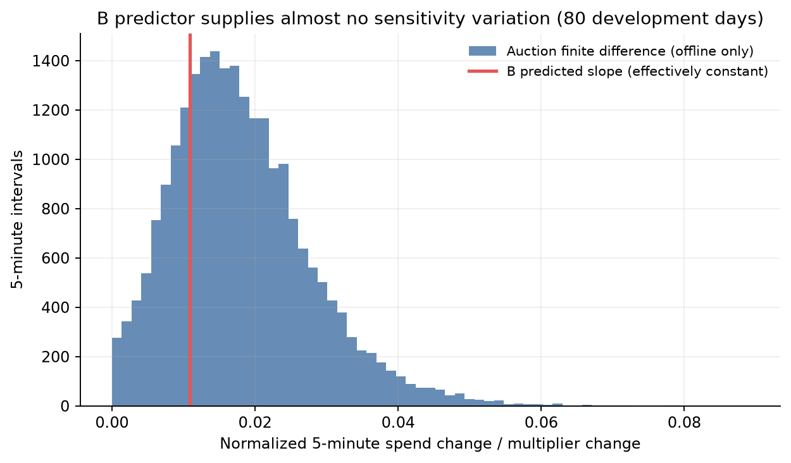
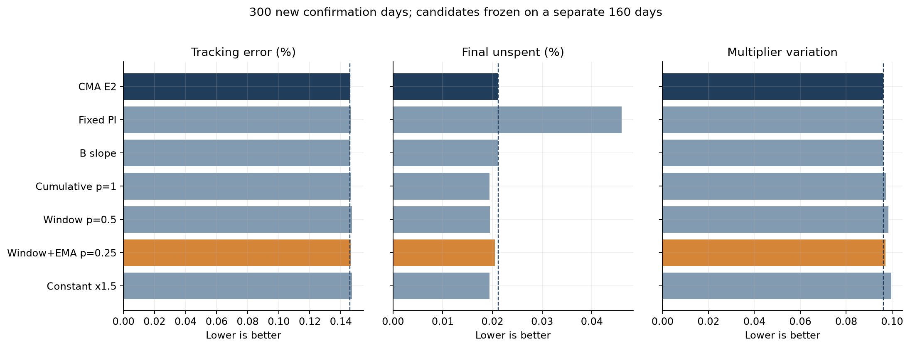
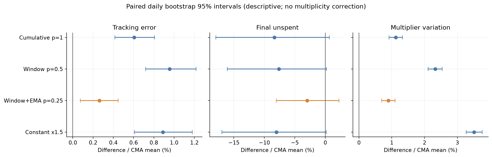
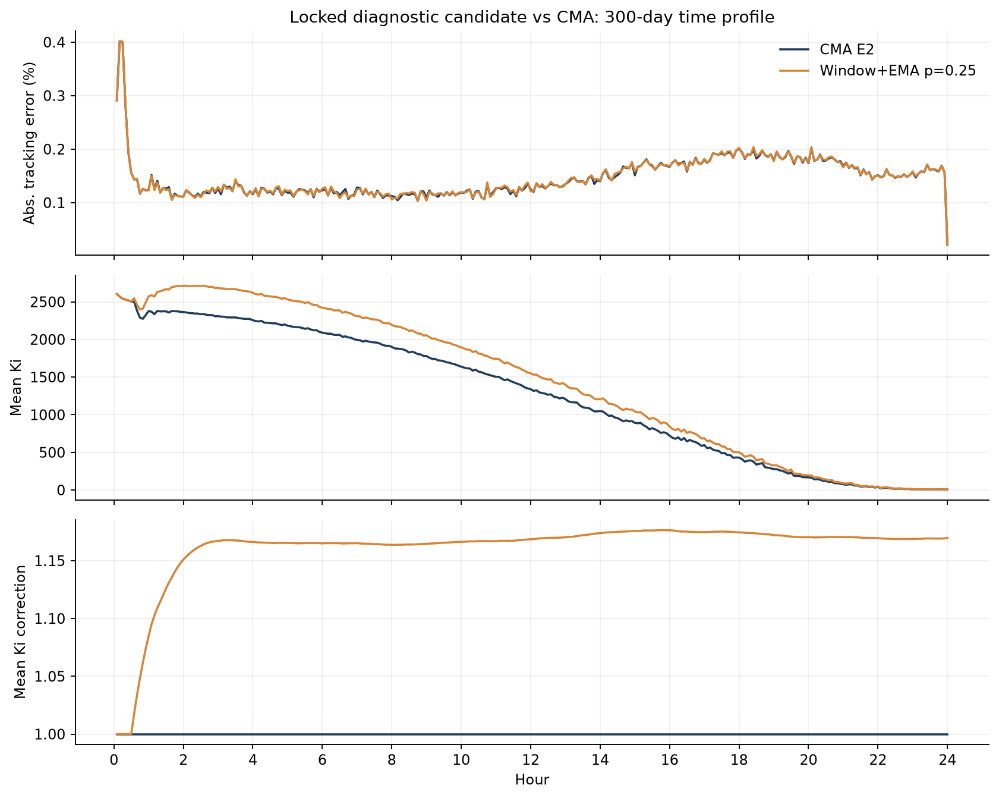
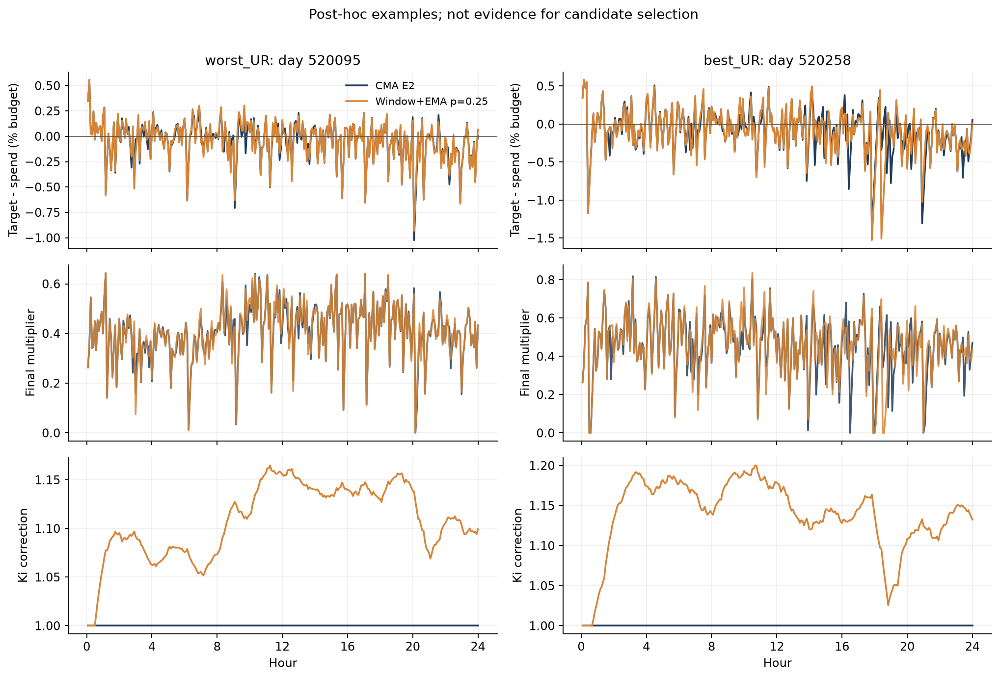

# 민감도 기반 Ki 보정 실험 — 2026-11-19

> **Ki 전용 공개 브랜치 안내**: 이 폴더의 기존 실험 결과·계획·프로토콜은 원본 그대로 보존했습니다. 공통 실행 코드 위치만 `pacing_ki_common`으로 분리했습니다. 현재 브랜치의 설치·검사·읽기 전용 재실행 방법과 원 실험 감사의 범위는 [공통 실행 안내](../pacing_ki_common/README.md)를 따릅니다.

NSGA-II 연구는 기존 3개 결과 묶음을 보존한 채 종료했다. 이번 실험은 새로운 최적화기로 CMA-ES를 재학습하는 작업이 아니라, **동결한 CMA E2 계수망의 Ki에 온라인 이득 보정을 추가하는 실험**이다. 새 브랜치 `feat/sensitivity-pi-20261119`, 시작 커밋 `ad090af`에서 수행했다.

**결론: 현재의 B 기울기 기반 보정은 사실상 변화가 없고, 관측 비율 기반 보정은 미소진율과 추종 정확도·승수 변동 사이의 절충을 바꿨다. 이번 설정은 채택하지 않고 기존 CMA를 유지한다.** 주 방식인 최근 1시간 관측 + EMA의 선택 후보는 새 300일에서 CMA 대비 미소진율 −2.98%, 추종 오차 +0.26%, 승수 변동 +0.89%였다. 미소진율 감소의 95% 신뢰구간은 0을 포함했다. 원 논문 전체의 효과를 부정하는 결과는 아니다.

## 1. 원 논문과 코드 공개 여부

첨부 연구 경과에서 제안한 논문은 Niklas Karlsson, Tina Fan, Dan Kirlin, Abhirup Mukherjee의 **Adaptive Spend Control for Programmatic Advertising via Input Reparameterization**, IEEE CDC 2026이다.

- [Amazon Science 공식 논문 페이지](https://www.amazon.science/publications/adaptive-spend-control-for-programmatic-advertising-via-input-reparameterization)
- [공식 PDF](https://cdn.amazon.science/eb/30/86a891d6459a9550880f82df1836/scipub-approval152129-49286955-adaptive-spend-control-for-programmatic-advertising-via-input-reparameterization.pdf)
- [Amazon Science Code and Datasets](https://www.amazon.science/code-and-datasets)

2026-11-19 기준 공식 페이지, 7쪽 PDF 전문, 공식 코드 목록 및 제목·저자·GitHub 대상 검색에서 **저자 제공 공개 코드 저장소를 찾지 못했다**. 공식 페이지에는 PDF 다운로드가 있으나 해당 논문의 코드 링크는 없었고, PDF에서도 코드 공개 절이나 `github`·`code` 표기를 찾지 못했다. 이는 확인한 범위의 결과이며 코드의 부재나 향후 비공개를 단정하지 않는다. 저자 코드를 사용하지 않았고, 수식을 참고해 프로젝트용 구현을 작성했다. 조사 기록은 [paper_review.json](results/paper_review.json)에 있다.

원문에서 구별해야 할 사항은 다음과 같다.

| 구분 | 논문 | 이번 구현 |
|---|---|---|
| 제어 입력 | 식 (4)의 `u = 1/(α+λ)`로 입찰 가치를 재매개화 | 기존 최종 입찰 승수 유지 |
| 이득 추정 | 첫날 사전값과 누적 `Σy/Σu`를 혼합, 다음 날부터 일 단위 갱신 | 첫날 혼합을 이식하고 1시간 창·일중 EMA를 별도 비교 |
| 제어기 | 식 (8)–(9): 구간 지출 오차에 대한 순수 I, 이득은 추정 plant gain의 역수에 비례 | 누적 지출 오차에 대한 기존 PI의 Ki만 상대 보정 |
| 시간·환경 | 2분 간격, 30일 캠페인, 계절성 보상 | 5분 간격, 하루 288구간, 매일 초기화 |

논문도 `Σy/Σu`가 편향된 추정임을 설명한다. 이를 국소 미분값과 동일하게 취급하지 않았다. 논문의 안정성 증명은 잡음·포화 등에 관한 가정을 두므로 현재 확률적 경매 PI에 그대로 적용하지 않는다. 따라서 이번 결과는 **논문에서 착안한 Ki 보정의 이식 실험**이며 논문 전체 재현 결과가 아니다.

## 2. 비교 방법과 고정한 조건

공통 조건은 B 선형회귀 예측기, E2 CMA 합산 기준 계수망, 목표 지출 경로, 경매 생성기, 승수 상한 1.0, 예산 검사, 기존 anti-windup이다. Kp를 산출하는 함수와 계수망 가중치는 바꾸지 않았다. 정책에 따라 관측 이력이 달라지므로 실제 Kp·기본 승수의 시간 경로까지 같다는 뜻은 아니다.

보정은 다음과 같다. `g_ref`와 `g_hat`은 예산으로 정규화한 5분 지출에 대한 값이다.

```text
factor = clip((g_ref / max(g_hat, 0.1*g_ref)) ** p, 0.5, 2.0)
Ki_new = clip(Ki_CMA * factor, 0, 6000)
I_candidate = I_previous + Ki_new * cumulative_error / 288
```

이전에 쌓인 가중 적분 상태를 새 Ki로 재배율하지 않는다. 출력이 포화 방향으로 가는 경우 새 적분 누적을 막는 기존 규칙을 유지한다. 관측 기반 추정에는 완료된 구간만 사용한다. 예산 제한으로 잘린 지출과 승수 ≤ 0.0001인 관측은 제외한다. 유효 관측 부족·음수·비유한 추정에서는 원래 Ki를 쓴다. 양의 입력인데 지출이 0인 경우는 유효한 저이득 관측으로 처리하되 보정 상한을 적용한다.

| 방식 | 구현 | 후보 수 |
|---|---|---:|
| S0_CMA | 동결한 팀 CMA E2 | 1 |
| F0_fixed | 기존 B 고정 PI: Kp 49.543385, Ki 300 | 1 |
| B 기울기 | B가 고른 기본 승수 주변 ±0.05의 예측 차분; 상태별·고정 PI 각각 | 2 |
| 첫날 누적 비율 | `g = (1-t/288)*g_ref + (t/288)*Σ(spend/B)/(1e-6+Σaction)` | 상태별·고정 각각 p ∈ {0.25, 0.5, 1} |
| 최근 1시간 비율 | 직전 12구간 중 유효 관측 6개 이상; `Σ(spend/B)/(1e-6+Σaction)` | 상태별 p ∈ {0.25, 0.5, 1} |
| 최근 1시간 + EMA | 위 추정을 `α = 1-exp(-1/6)`으로 평활, 약 30분 시정수 | 상태별·고정 각각 p ∈ {0.25, 0.5, 1} |
| 상수 Ki 대조군 | CMA의 Ki에 상수만 곱함 | 0.5, 0.75, 1.25, 1.5, 2배 |

총 24개 정책을 비교했다. 관측 비율의 사전값은 논문 초기화에서 착안한 `(1/288)/m0 = 0.0131584998621`이다. B 기울기 방식의 기준값은 회귀 계수에서 계산한 `0.0108959465909`다. **일중 EMA는 우리 확장**이며 논문의 일 단위 갱신과 다르다. 상수 대조군은 관측 적응의 효과와 단순 Ki 증폭의 효과를 구별하기 위해 포함했다.

## 3. 평가 설계와 선택 규칙

| 용도 | 날짜 ID | 일수 | 사용 |
|---|---|---:|---|
| 개발 진단 | 400000–400079 | 80 | 기존 연구에서도 사용한 자료; 새 학습이나 가중치 탐색 없음 |
| 설정 선택 | 420000–420159 | 160 | 이번에 새로 사용; 방식별 p/상수 선택 |
| 독립 확인 | 520000–520299 | 300 | 선택 파일·소스 동결 후 평가 |
| 구현 검사 | 600000–600004 | 5개 허용 | 기존 검사 자료; 단위 검사는 앞의 2일 사용 |
| 최종 테스트 | 200000–200499 | 500 | **미사용, 실행 차단** |

24개 정책과 주 방식 `state_window_smooth`를 개발 평가 전에 고정했다. 각 방식은 선택 자료에서 기준 대비 **TE·UR 평균 비악화와 V 감소를 모두 만족**하는 후보 중 J가 최소인 것을 채택 후보로 정한다. 해당 후보가 없으면 기존 정책을 유지한다. 동시에 각 방식의 J 최소 후보를 진단용으로 고정하여 새 300일에서 비교한다. 고정 PI의 보정은 F0를, 상태별 PI 보정은 S0를 선택 단계의 기준으로 삼는다. CMA 대체 여부는 최종적으로 S0와 비교한다.

이 기준은 앞선 NSGA-II에서 다뤘던 정확도 유지·변동 감소를 함께 점검하기 위해 본 실험에서 정한 기준이다. 원 논문의 필수 성공 기준은 아니다. **정확도 지표의 변화와 J 감소 자체도 별도로 보고**하므로 V가 감소하지 않았다는 이유만으로 모든 효과를 없다고 처리하지 않는다.

- TE: 하루 평균 절대 누적 지출 격차 / 예산.
- UR: 하루 마감 미소진액 / 예산.
- J: TE + UR.
- V: 연속 5분 구간 입찰 승수의 평균 절대 변화량. 단위는 승수이며 백분율이 아니다.

같은 날짜는 모든 정책에서 동일한 경매 테이프와 예산을 쓴다. 신뢰구간은 날짜를 짝지은 20,000회 bootstrap으로 산출했다. 다중 비교를 보정하지 않은 기술적 구간이며, 0을 포함한다고 동등성·비열등성이 증명되는 것은 아니다. 선택 자료 160일의 CMA 평균 TE는 0.223851%, 새 확인 300일에서는 0.145875%였다. 표본 구성에 따른 차이가 있으므로 **서로 다른 날짜 묶음의 평균을 정책 효과로 비교하지 않는다.**

## 4. B 예측기의 민감도에는 적응 정보가 거의 없다

B는 후보 승수가 다른 특징과 곱해지지 않는 선형회귀다. 예측값의 0 하한에 걸리지 않는 구간에서는 승수에 대한 기울기가 회귀 계수 하나로 정해진다. 개발 80일의 22,960개 구간 모두에서 계산한 기울기가 이 상수의 ±0.1% 안에 있었다.

| 진단 | 값 |
|---|---:|
| B 기울기 중앙값 | 0.010895947926 |
| B 기울기 변동계수 | 0.000000253 |
| 실제 경매 차분 기울기 5% / 중앙값 / 95% | 0.004376 / 0.016807 / 0.035967 |
| 실제 경매 차분 기울기 변동계수 | 0.538892 |

실제 경매 차분은 정책 실행이 끝난 뒤 동일 구간의 테이프에서 기본 승수 ±0.05의 지출을 계산한 진단이다. 예산 제한을 배제한 잠재 지출 반응이며, 낙찰 문턱을 포함하는 유한 차분이다. **제어 입력이나 후보 선택용 실시간 특징으로 전달하지 않았다.** 이를 관측 비율 추정의 불편향 정답으로 사용하지도 않았다.



B 기울기 보정의 실제 factor는 약 1.000000이며, 새 300일에서도 CMA와 수치 반올림 수준의 차이만 생겼다. 기준값을 다르게 잡으면 상수 Ki 배율은 바꿀 수 있지만 상태 적응 정보가 새로 생기지는 않는다.

## 5. 선택 결과와 새 300일 결과

선택 160일에서 **보정 방식 8개 모두 엄격한 세 지표 기준을 통과한 후보가 없었다.** 따라서 주 정책은 S0_CMA로 유지되었다. 아래 보정 모델은 모두 선택 단계에서 미리 고정한 **진단용 후보**이며, 새 300일을 보고 가장 좋은 후보를 다시 선택한 표가 아니다.

| 모델 | 선택된 진단 설정 | TE (%) ↓ | UR (%) ↓ | J (%) ↓ | V ↓ |
|---|---|---:|---:|---:|---:|
| CMA E2 기준 | 변경 없음 | 0.145875 | 0.021141 | 0.167016 | 0.096229 |
| B 기울기 + CMA | p=1 | 0.145875 | 0.021141 | 0.167016 | 0.096229 |
| 첫날 누적 비율 + CMA | p=1 | 0.146758 | 0.019376 | 0.166134 | 0.097312 |
| 최근 1시간 + CMA | p=0.5 | 0.147271 | 0.019534 | 0.166805 | 0.098468 |
| 최근 1시간 + EMA + CMA | p=0.25, 사전 지정 주 방식 | 0.146257 | 0.020511 | 0.166768 | 0.097090 |
| 상수 Ki 대조군 | 1.5배 | 0.147173 | 0.019446 | 0.166619 | 0.099607 |
| 고정 PI 기준 | 변경 없음 | 0.146449 | 0.046001 | 0.192451 | 0.096155 |
| B 기울기 + 고정 PI | p=1 | 0.146449 | 0.046001 | 0.192451 | 0.096155 |
| 첫날 누적 비율 + 고정 PI | p=0.25 | 0.146437 | 0.046852 | 0.193290 | 0.096329 |
| 최근 1시간 + EMA + 고정 PI | p=0.25 | 0.146120 | 0.047279 | 0.193399 | 0.096467 |



주 방식의 진단 후보는 CMA 대비 TE **+0.2617%**, UR **−2.9810%**, J **−0.1488%**, V **+0.8948%**였다. 이 변화율은 상대 변화이며 위 표의 예산 대비 %와 구별한다.

| 주 진단 후보 − CMA | 평균 차이 | 짝지은 95% 구간 | 개선 / 악화 일수 |
|---|---:|---|---:|
| TE (%p) | +0.000382 | [+0.000107, +0.000654] | 129 / 171 |
| UR (%p) | −0.000630 | [−0.001697, +0.000477] | 165 / 135 |
| J (%p) | −0.000248 | [−0.001348, +0.000886] | 167 / 133 |
| V | +0.000861 | [+0.000665, +0.001060] | 72 / 228 |

TE와 V의 구간은 악화 방향에 있다. UR과 J의 감소는 이 표본에서 불확실하며, 소진 성능 개선이 재현된다고 단정할 근거는 부족하다.

첫날 누적 방식은 평균 UR을 **8.35%**, J를 **0.53%** 낮췄지만 TE **0.61%**, V **1.13%** 증가가 동반되었다. 상수 1.5배도 UR **8.02%** 감소와 TE **0.89%**, V **3.51%** 증가를 보였다. 따라서 소진 개선의 일부는 민감도를 정확하게 식별한 결과라기보다 Ki를 더 크게 쓰는 효과일 수 있다. 누적 방식이 상수 방식보다 이번 평균에서는 유리한 점은 후속 검토 대상이며, 그 자체로 비악화 조건 충족이나 적응 기법의 통계적 우위를 증명하지 않는다.



## 6. 왜 기대한 개선으로 이어지지 않았는가

**확인된 사실 1 — B 기울기는 상태를 구별하지 못했다.** 선형회귀의 구조와 차분 값이 이를 뒷받침한다. 기존 B 기울기를 보정 입력으로 추가하는 것만으로 경매 반응 변화에 적응할 수 없다.

**확인된 사실 2 — 관측 기반 보정은 대부분의 시간에 Ki를 늘렸다.** 주 진단 후보의 factor 평균은 **1.1613**, 5–95% 범위는 **1.0116–1.3035**였다. 구간의 **96.12%**에서 factor > 1, **1.79%**에서 factor < 1이었다. 평균 Ki는 CMA의 **1264.14 → 1448.13**으로 증가했다. 첫날 누적 p=1도 평균 factor **1.3373**, 마감 4시간 평균 **1.7188**이었다. 초기 승수에 근거한 사전값 0.0131585가 주 후보의 관측 이득 중앙값 0.0072744보다 커서 역비례 보정이 대체로 증폭 방향으로 작동했다.

**해석 — 비율 추정에는 환경의 반응과 운영점 변화가 함께 들어간다.** `Σ지출/Σ승수`는 `∂지출/∂승수`와 같지 않으며, 현재 정책·교통량·낙찰 문턱의 영향을 받는다. 누적 오차 PI에 이 값을 곧바로 역비례 적용했을 때 “소진을 더 밀어 주지만 움직임과 추종 오차도 늘리는” 결과가 나타났다. 상수 Ki 대조군도 비슷한 절충을 보였다는 점은 이 해석을 지지하지만, 각 원인의 기여도를 분리한 인과 실험은 아니다.

**확인된 사실 3 — 평활만으로 정확도·변동 절충이 해결되지 않았다.** 주 후보에서 factor 변동은 작았지만 최종 승수의 V는 여전히 CMA보다 컸다. 선택된 raw 후보는 p=0.5, EMA 후보는 p=0.25이므로 두 후보 간 차이를 EMA 단독 효과로 해석하지 않는다.

**이번 주 후보의 주요 제한은 보정 상한에 잘리는 현상으로 보이지 않는다.** factor 상·하한 도달로 잘린 구간과 Ki 6000 상한 구간은 모두 0%였다. 관측 부족 fallback은 약 2.09%였고, 최종 승수 포화율은 CMA **1.8299% → 1.8368%**였다. 출력 포화는 존재하지만 “보정 상한만 늘리면 해결된다”는 근거는 없다.





마지막 그림은 주 진단 후보의 UR 차이가 가장 나쁘고 좋은 확인 날짜를 **평가 후 설명용으로** 고른 것이다. 선택 기준이나 일반적인 성능 증거로 사용하지 않았다. 날짜와 선택 규칙은 [case_selection.json](results/case_selection.json)에 기록했다.

## 7. 검증, 실행 비용, 재현

9개 검사에서 기존 CMA 경로 재현, 24개 정책의 독립 구현 일치, 미래 경매 변경에 대한 과거 행동 불변, 잘린 관측 제외, Ki 변경 시 누적 적분 보존, 승수·예산 한도, 정확도 절충 후보의 잘못된 채택 방지, 최종 테스트 접근 차단을 확인했다. 검사 과정의 모듈 이름 충돌은 프로토콜 동결 전에 수정했다.

새 확인 300일 × 10개 정책을 원본 `core.rollout`과 독립 Python 제어기로 다시 실행했다. 가속 평가기와 6개 지표의 최대 절대 차이는 **4.17 × 10⁻¹⁶ 미만**이었다. 날짜별 테이프 동일성, 소스 해시, 선택 후 확인 평가 순서도 통과했다. 이전 NSGA-II 실험 코드는 변경하지 않았다.

| 작업 | 일 단위 실행 수 |
|---|---:|
| 개발 자료: 24 × 80 | 1,920 |
| 설정 선택: 24 × 160 | 3,840 |
| 새 확인: 10 × 300 | 3,000 |
| 독립 Python 재검산 | 3,000 |
| 완료 후 설명용 추적 재실행 | 3,000 |

합계 14,760회이며, 구현 검사·개발 민감도 진단의 CMA 80회 재실행은 별도다. 신경망 학습과 확률적 최적화 시드는 없다. 확인 평가와 원본 재검산은 합계 약 80.7초였으며 환경 준비·검사·시각화 시간은 제외한다. 설정 선택의 실행 시간은 `selection.json`에 보존했다.

```powershell
.\outputs\ki-venv\Scripts\python.exe -m unittest discover -s research_report/pacing_sensitivity_pi/code -p 'test_*.py' -v
.\outputs\ki-venv\Scripts\python.exe research_report/pacing_ki_common/code/verify_export.py
.\outputs\ki-venv\Scripts\python.exe research_report/pacing_ki_common/code/replay.py --bundle pacing_sensitivity_pi --days 2
```

의존성 버전은 [기존 환경 lock](../pacing_ki_common/requirements.txt)을 사용한다. 완료된 결과는 `all` 재호출로 다시 선택하거나 덮어쓰지 않는다. 독립 재현은 별도 작업 복사본의 새 결과 디렉터리에서 수행한다. 프로토콜 동결 후 실험 코드 변경은 해시 검사로 거부되며, 결과 설명용 `report.py`만 이 검사에서 제외한다. 해당 보고 스크립트의 해시는 별도로 저장한다.

주요 파일:

- [protocol.json](results/protocol.json): 사전 고정 설계·날짜·전체 후보·실험 소스 해시.
- [selection.json](results/selection.json): 새 확인 평가 전에 고정한 후보와 점수.
- [fresh_summary.csv](results/fresh_summary.csv), [fresh_daily.csv](results/fresh_daily.csv), [fresh_paired.csv](results/fresh_paired.csv): 평균·날짜별 지표·차이와 신뢰구간.
- [controller_diagnostics.csv](results/controller_diagnostics.csv): 보정 배율·Ki·포화·fallback 진단.
- [primary_model.json](results/primary_model.json), [audit.json](results/audit.json): 미채택 판정·검증 기록.
- [controller.py](code/controller.py): 독립 제어기 구현. [fast_sensitivity.py](code/fast_sensitivity.py): 가속 실행. [experiment.py](code/experiment.py): 평가·선택 절차.

## 8. 해석 범위와 다음 가설

이 실험은 실제 경매 자료로 교정하지 않은 first-price 시뮬레이터, 하루 단위 에피소드, 동결한 CMA E2, 위의 유한 후보 집합에 한정된다. 논문의 입력 재매개화·계절성 보상·여러 날의 적응이나 순수 I 설계를 평가하지 않았다. 결과가 좋지 않았다는 이유로 논문 자체 또는 민감도 적응 일반이 실패했다고 결론내리지 않는다. 최종 테스트 500일은 계속 미사용으로 둔다.

후속 실험이 필요하다면 먼저 **관측 이득의 기준값을 개발 자료에서 보정해 factor가 거의 항상 1보다 커지는 편향을 줄이고, 평균 배율을 맞춘 상수 대조군과 비교**해야 한다. 그 다음으로 B 예측기에 승수와 경매 상태의 상호작용을 넣어 실제로 달라지는 기울기를 추정할 수 있는지 별도 검증할 수 있다. 두 변경을 함께 적용하거나 이번 확인 300일에서 재선택하면 원인을 구분하기 어려우므로 새 선택·확인 자료가 필요하다. 이 후속 변경은 이번 결과에 섞어 실행하지 않았다.
