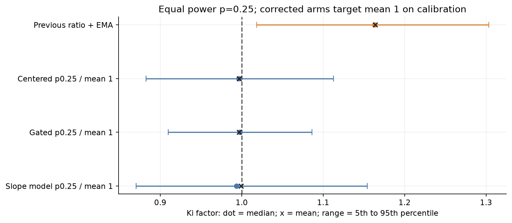
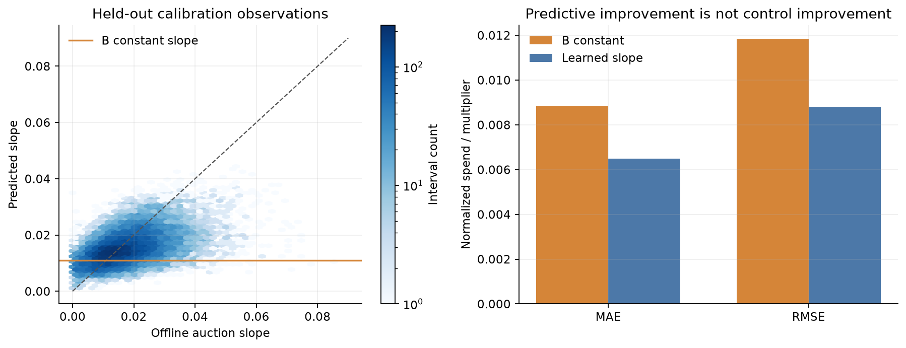
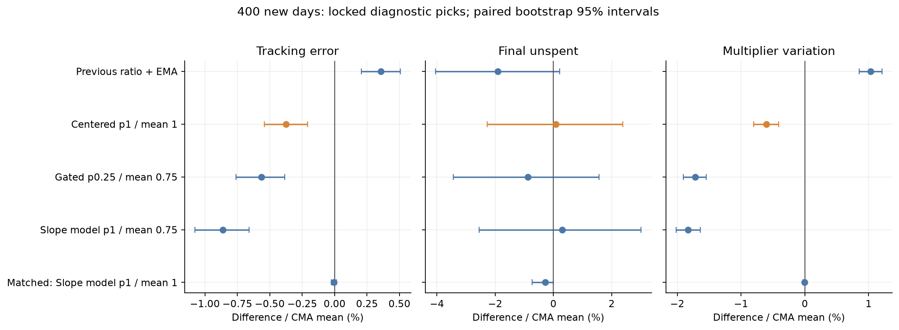
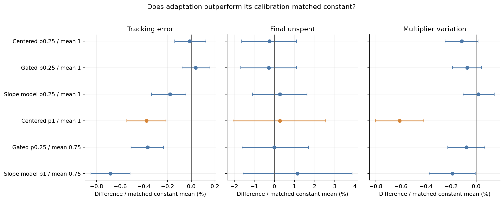
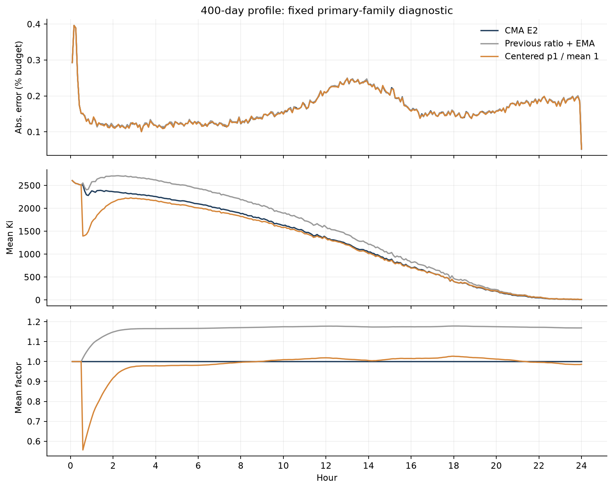

# 민감도 기반 Ki 개선 실험: 중심 보정·관측 신뢰도·기울기 학습

> **Ki 전용 공개 브랜치 안내**: 이 폴더의 기존 실험 결과·계획·프로토콜은 원본 그대로 보존했습니다. 공통 실행 코드 위치만 `pacing_ki_common`으로 분리했습니다. 현재 브랜치의 설치·검사·읽기 전용 재실행 방법과 원 실험 감사의 범위는 [공통 실행 안내](../pacing_ki_common/README.md)를 따릅니다.

2026-11-19, 시작 커밋 `41b9c48`. [사전 계획](PLAN.md)에 따라 세 개선안을 구현하고 새로운 400일에서 확인했다. NSGA-II는 종료 상태를 유지하며 기존 결과를 변경하지 않았다.

**Ki가 거의 항상 커지는 편향은 줄였고, 추종 오차와 승수 변동을 함께 낮추는 후보를 확보했다.** 다만 사전 지정 주 방식인 중심 보정의 선택 후보는 미소진율 평균이 소폭 높아져 전체 성공 기준을 통과하지 못했다. 별도 비교한 신뢰도 보정 후보는 세 지표의 평균 기준을 모두 통과했으나, 미소진율 개선은 불확실하고 초반 Ki 유지 효과가 섞여 있다. 따라서 **CMA를 유지하면서 신뢰도 보정 후보를 후속 검증 대상으로 남긴다.** 확인 자료를 본 뒤 주 방식을 바꿔 성공으로 처리하지 않았다.

## 1. 문제와 실행한 개선안

| 앞선 실험의 문제 | 이번에 실행한 변경 | 효과를 구별하기 위한 비교 |
|---|---|---|
| 초기 승수에서 구한 기준 이득 때문에 대부분 Ki가 증가 | 별도 자료에서 보정 배율의 평균을 0.75·1·1.25로 맞춤 | 각 적응 후보와 실제 평균 배율을 맞춘 상수 대조군 |
| 지출/승수 비율의 잡음과 편향 | 최근 관측의 잔차 변동이 크면 적응 성분을 축소 | 같은 p=0.25, 목표 평균 1에서 중심 보정과 직접 비교 |
| B 선형회귀의 기울기가 사실상 상수 | 과거 경매 관측과 기본 승수의 상호작용으로 차분 기울기 예측 | 상수 B 기울기와 예측 오차 비교, 동일 제어 환경에서 평가 |
| 선택 자료의 개선이 새 날짜에서 유지되지 않을 가능성 | 학습·배율 보정·설정 선택·확인을 분리 | 모델·배율·선택 파일을 확인 평가 전에 동결 |

변경한 것은 **동결한 CMA E2가 산출한 Ki에 곱하는 배율**이다. B 지출 예측기, CMA 가중치와 Kp 산출 함수, 목표 경로, 승수 상한 1.0, 기존 anti-windup과 누적 적분 상태는 유지했다. 정책의 관측 이력이 달라지므로 실제 Kp나 기본 승수의 경로까지 같다는 의미는 아니다. 추가 기울기 모델은 Ki 보정에만 사용한다.

## 2. 구현과 실험 설계

### 보정 배율

```text
factor = clip(target_mean * exp(q * (center - p * log(max(g_est, 1e-8)))), 0.5, 2)
Ki_new = clip(Ki_CMA * factor, 0, 6000)
I_candidate = I_previous + Ki_new * cumulative_error / 288
```

- `p ∈ {0.25, 0.5, 1}`, 목표 평균 `∈ {0.75, 1, 1.25}`.
- 중심 보정·기울기 모델 방식은 `q=1`이다. 신뢰도 방식은 최근 12구간의 지출/승수 비율 잔차로 구한 상대 표준오차 `r`에 대해 `q=1/(1+(r/0.25)^2)`를 사용한다. 직렬 상관을 보정한 통계적 신뢰구간이 아니라 사전 고정한 휴리스틱이다.
- 최근 관측을 EMA `α=1-exp(-1/6)`으로 평활한다. 예산 제한으로 잘린 지출과 승수 ≤ 0.0001인 관측을 제외하고, 유효 관측이 6개 미만이면 factor=1이다.
- 중심값은 보정 자료의 CMA 경로에서 전체 구간 평균 factor가 목표와 같도록 구한다. 이후 각 적응 정책을 같은 보정 자료에서 실제 실행하고, 그때의 평균 factor를 상수 대조군에 적용한다.
- 확인 자료에서는 중심이나 상수 배율을 다시 맞추지 않는다. 따라서 확인 자료의 실제 평균 배율은 대조군과 다를 수 있다. 평균 Ki나 오차로 가중한 적분 누적량까지 일치시키는 비교도 아니다.
- `q`가 작아지면 적응 성분이 줄어들어 목표 상수 배율에 가까워진다. 목표가 0.75인 경우 CMA의 factor=1로 복귀하는 규칙은 아니다. 관측 부족 fallback은 별도로 factor=1이다.

### 기울기 모델

학습 240일에서 CMA 경로의 **현재 구간 기본 승수 ±0.05**에 대한 예산 정규화 지출 차분을 정답으로 만들었다. 이 정답은 예산 제약을 배제한 잠재 경매 반응으로, 낙찰 문턱을 포함하는 유한 차분이다. 배포 시 현재 경매를 미리 관측하는 입력으로 사용하지 않는다.

입력은 기본 승수와 제곱, 예산, 시간의 사인·코사인, 과거 승수·지출·낙찰률·기회수·기본 입찰가의 통계, 누적 오차 및 승수와 과거 상태의 상호작용으로 구성한 18개 특징이다. 학습 자료에서만 표준화하고, 로그 기울기를 ridge 회귀(α=100 고정)로 학습했다. 예측 시 표준화 특징은 ±8, 기울기는 `[1e-5, 0.2]`로 제한한다. 검증 결과를 보고 특징이나 규제 강도를 다시 고르지 않았다.

실제 운영에서 이 방식의 정답을 만들려면 경쟁 입찰 정보와 반사실적 지출을 얻을 수 있는지 확인해야 한다. 이번에는 시뮬레이터의 개발 테이프에서만 정답을 만들었으며, 원 논문의 전체 제어기를 재현한 것은 아니다.

### 자료와 선택 규칙

| 용도 | 날짜 ID | 일수 | 역할 |
|---|---|---:|---|
| 기울기 학습 | 400000–400239 | 240 | 기존 연구의 개발 자료, 66,240개 구간 |
| 중심·상수 보정 | 430000–430079 | 80 | 새 자료, 모델은 재학습하지 않음 |
| 설정 선택 | 440000–440199 | 200 | 새 자료에서 방식별 p·목표 평균 선택 |
| 독립 확인 | 530000–530399 | 400 | 모든 설정을 동결한 뒤 평가 |
| 최종 테스트 | 200000–200499 | 500 | **미사용, 접근 차단** |

적응 후보 27개, 각 후보의 평균 배율을 맞춘 상수 27개, 상수 0.75·1.25의 2개, CMA와 앞선 비율·EMA 후보의 2개로 **58개 정책**을 선택 자료에서 비교했다. 이들 중 선택 후보·진단 후보·사전 고정 소거 비교에 필요한 **16개 정책**을 확인 자료에서 평가했다.

주 방식은 사전에 `centered_ratio`로 정했다. 각 방식에서 CMA 대비 **TE·UR 평균 비악화와 V 감소**를 모두 만족하는 후보 중 J 최소를 고르고, 없으면 CMA를 유지한다. 제약 없이 J가 최소인 진단 후보도 별도로 고정한다. 추가로 p=0.25·목표 평균 1인 세 방법을 점수와 관계없이 확인하도록 사전 지정했다. 결과를 본 뒤 후보를 추가하거나 재선택하지 않았다.

TE는 평균 절대 누적 지출 격차/예산, UR은 마감 미소진액/예산, J는 TE+UR, V는 연속 승수의 평균 절대 변화다. 표의 TE·UR·J는 예산 대비 %, V는 승수 단위다. 차이의 신뢰구간은 날짜를 짝지은 20,000회 bootstrap으로 산출했다. 다중 비교를 보정하지 않은 기술적 구간이며 평균 기준 통과와 통계적 확실성을 구분한다.

## 3. 실제로 해결된 부분

### 평균 Ki 증폭 편향

같은 p=0.25, 목표 평균 1에서 확인한 결과다. 앞선 비율·EMA 후보도 동일한 400일에 다시 평가했다.

| 방식 | 확인 자료 평균 factor | factor > 1인 구간 | factor 5–95% 범위 |
|---|---:|---:|---|
| 앞선 비율·EMA | 1.1640 | 96.62% | 1.0182–1.3035 |
| 중심 보정 | 0.9967 | 45.87% | 0.8826–1.1125 |
| 중심 + 신뢰도 | 0.9970 | 46.10% | 0.9097–1.0862 |
| 학습 기울기 | 0.9991 | 44.84% | 0.8703–1.1540 |

거의 항상 Ki를 늘리던 문제는 해소됐다. 다만 이것만으로 정확도나 소진 개선이 보장되지는 않는다.



### 상태에 따른 기울기 예측

학습에 쓰지 않은 보정용 80일의 22,080개 구간에서 측정했다. 이 구간의 정답은 예측 성능 진단에만 사용했고 모델을 재학습하거나 선택하지 않았다.

| 지표 | B 상수 기울기 | 학습 기울기 |
|---|---:|---:|
| 평균 절대 오차 | 0.008849 | 0.006481 |
| RMSE | 0.011848 | 0.008800 |
| 실제 차분과 상관 | 상수여서 해석 불가 | 0.4890 |

MAE 약 **26.8%**, RMSE 약 **25.7%** 감소다. 실제 반응의 변동계수는 0.5455, 예측은 0.3567로 급격한 변동을 충분히 포착하지 못하는 한계가 남았다.



## 4. 새 400일의 제어 성능

아래 개선 모델과 상수 모델은 모두 **선택 200일에서 정한 제약 통과 후보**다. 주 방식인 중심 보정과 나머지 비교 방식을 구분한다.

| 모델 | 선택 설정 | TE (%) ↓ | UR (%) ↓ | J (%) ↓ | V ↓ |
|---|---|---:|---:|---:|---:|
| CMA E2 | 기준 | 0.161981 | 0.052309 | 0.214290 | 0.098839 |
| 앞선 비율·EMA | 기존 p=0.25 | 0.162556 | 0.051308 | 0.213865 | 0.099856 |
| 중심 보정 — 주 방식 | p=1, 목표 평균 1 | 0.161375 | 0.052352 | 0.213727 | 0.098240 |
| 중심 + 신뢰도 | p=0.25, 목표 평균 0.75 | 0.161069 | 0.051851 | 0.212920 | 0.097137 |
| 학습 기울기 | p=1, 목표 평균 0.75 | 0.160584 | 0.052463 | 0.213047 | 0.097030 |
| 선택된 상수 대조군 | factor=0.7505747 | 0.161658 | 0.051907 | 0.213565 | 0.097209 |

| 모델 | CMA 대비 TE | UR | J | V | 세 지표 평균 기준 |
|---|---:|---:|---:|---:|---|
| 중심 보정 | −0.374% | +0.082% | −0.263% | −0.606% | 미통과 |
| 중심 + 신뢰도 | −0.563% | −0.875% | −0.639% | −1.721% | 통과 |
| 학습 기울기 | −0.862% | +0.294% | −0.580% | −1.830% | 미통과 |
| 선택된 상수 대조군 | −0.200% | −0.768% | −0.338% | −1.649% | 통과 |

상대 변화율이다. 중심 보정의 UR 증가분은 **+0.000043%p**로 매우 작고 차이의 95% 구간은 `[−0.001190, +0.001243]%p`였다. 확실한 악화라고 말할 근거는 없지만, 사전 지정한 엄격한 평균 비악화 기준은 통과하지 못했다.

신뢰도 보정 후보의 CMA 대비 차이는 다음과 같다.

| 지표 | 평균 차이 | 짝지은 95% 구간 | 개선 / 악화 일수 |
|---|---:|---|---:|
| TE (%p) | −0.000912 | [−0.001232, −0.000622] | 249 / 151 |
| UR (%p) | −0.000458 | [−0.001797, +0.000818] | 177 / 223 |
| J (%p) | −0.001370 | [−0.002746, −0.000073] | 195 / 205 |
| V | −0.001701 | [−0.001880, −0.001527] | 351 / 49 |

TE·V와 보정 없는 J 구간은 개선 방향이다. **UR은 개선이 불확실하고, 오히려 악화된 날짜가 더 많다.** 따라서 모든 날짜에서 예산 소진이 좋아졌다고 해석하지 않는다. 이 후보는 사전에 비교 대상으로 포함했지만 주 방식은 아니므로 후속 검증 후보로 취급한다.



위 그림의 상수 행은 제약 없이 J가 최소인 진단용 상수(`1.0008374`)를 보여준다. 본문 표의 상수(`0.7505747`)는 세 지표 제약을 통과한 선택 후보다. 두 역할의 결과는 [전체 표](results/report_tables.md), [방식별 판정](results/method_comparison.csv)에 모두 보존했다.

## 5. 적응 자체의 이득인가

### 평균 배율을 맞춘 상수와 비교

신뢰도 후보에 대응하는 상수는 보정 자료에서 정한 **0.7500468**이다. 확인 자료에서 적응 후보의 실제 평균 배율은 **0.7478935**였다. 평균 Ki는 각각 적응 **946.15**, 상수 **948.92**로 가까웠다.

| 신뢰도 후보 − 대응 상수 | 평균 차이 | 95% 구간 |
|---|---:|---|
| TE (%p) | −0.000597 | [−0.000823, −0.000377] |
| UR (%p) | −0.000009 | [−0.000835, +0.000871] |
| V | −0.000074 | [−0.000221, +0.000066] |

단순 상수 감소만으로도 상당한 V 감소가 발생했다. 적응 후보는 추가 추종 개선을 보였으나, 상수 대비 추가 소진·변동 개선은 불확실하다.

### 초기 동작 차이가 남아 있다

적응 후보는 유효 관측이 쌓이는 **처음 6구간(30분)에서 factor=1**을 쓰지만 상수 대조군은 처음부터 약 0.75를 쓴다. 설명용 시간 구간 분석에서 상수 대비 전체 TE 감소 **0.0005967%p 중 0.0004529%p, 약 75.9%가 처음 30분에 발생**했다. 이는 민감도 정보 없이도 두 정책이 다르게 움직이는 구간이다.

이 관측은 개선의 상당 부분이 초기 동작 유지와 관련될 가능성을 보여주지만, 시간 구간별 기여도를 인과적 효과 분해로 해석하지 않는다. 이후 구간에는 초기 제어의 영향도 남는다. **현재 상수 대조군은 평균 배율은 맞췄지만 초기·fallback 경로까지 맞추지는 않았다.** 다음 검증에서는 첫 30분과 fallback 조건도 같은 상수 정책을 반드시 비교해야 한다.

### 신뢰도 감쇠만의 효과

서로 다른 방식에서 선택된 최적 p·목표 평균을 비교해 신뢰도 감쇠 단독의 효과라고 말하지 않는다. 사전 고정한 동일 조건(p=0.25, 목표 평균 1)의 결과는 다음과 같다.

| 방식 | CMA 대비 TE | UR | V |
|---|---:|---:|---:|
| 중심 보정 | −0.012% | −0.250% | −0.115% |
| 중심 + 신뢰도 | +0.036% | −0.283% | −0.072% |
| 학습 기울기 | −0.177% | +0.257% | +0.029% |

동일 조건의 신뢰도 방식과 중심 보정 사이에서는 세 지표 차이의 구간이 모두 0을 포함했다. 신뢰도 감쇠가 단독으로 성능을 높였다는 증거는 부족하다. 중심 보정의 이 소규모 후보는 세 지표 평균이 모두 낮았지만 확인 결과를 보고 주 후보로 교체하지 않았다.



## 6. 남은 문제와 다음 검증 순서

1. **상수 비교와 추정기의 초기 동작:** 신뢰도 후보는 추가 검증할 가치가 있으나, 먼저 처음 30분과 fallback을 동일하게 둔 상수 0.75 대조군으로 적응 고유의 이득을 분리해야 한다. 중심을 재보정하면서 EMA 초기 이득은 앞선 사전값으로 유지했기 때문에, 주 후보는 적응 시작 시 배율이 크게 낮아지는 과도 응답도 보였다. 초기 이득 설정과 중심 보정의 조합을 따로 검증할 필요가 있다. 이 결과를 본 400일에서 새 대조군을 선택하는 대신 새 독립 확인 자료가 필요하다.
2. **미소진율의 불확실성:** 주 후보는 UR 평균 비악화에 실패했고, 신뢰도 후보의 UR 감소 구간은 0을 포함한다. 작은 상대 개선이나 J 감소만으로 소진의 비열등성을 선언하지 않는다. 후속에서는 허용 가능한 비열등성 한계와 표본 수를 평가 전에 정해야 한다.
3. **기울기 모델의 예측과 제어 간 차이:** 예측 MAE는 개선됐지만 선택 후보의 UR은 유지되지 않았다. 기울기는 B 기본 승수 주변에서 예측하며 실제 적용 승수는 PI 보정 후 달라진다. 또한 EMA 지연이 있다. 이 두 요인은 후속 가설이며 이번에 개별 기여도를 검증하지 않았다.
4. **보정 범위 제한의 영향:** 학습 기울기 선택 후보는 약 16.96% 구간에서 factor 제한에 잘렸고, 신뢰도 후보는 0%였다. 모델 정확도 개선만으로 해결되지 않는 설계 문제다. 상·하한을 바꾸는 실험은 별도 조건으로 분리해야 한다.

현재 판단은 **증폭 편향 완화는 확인, 추종·변동 개선은 진전, CMA 대체는 보류**다. 상수 감소도 효과를 냈으므로 더 복잡한 추정기를 우선 채택할 근거는 아직 충분하지 않다. 위 후속 가설을 이번 확인 결과에 맞춰 추가 실행하거나 선택하지 않았다.



## 7. 재현·검증·실행 비용

9개 검사에서 기존 CMA·앞선 민감도 정책 재현, 모든 방법·강도·목표 조합의 두 구현 일치, 특징 계산 일치, 평균 보정, 미래 경매 변경에 대한 과거 행동 불변, 예산으로 잘린 관측 제외, 적분 상태 보존, 선택 규칙 및 최종 테스트 차단을 확인했다.

16개 정책 × 400일을 원본 Python 시뮬레이터에서 재실행했다. 가속 평가기와 6개 지표의 최대 절대 차이는 **4.03×10⁻¹⁶ 미만**이었다. 소스·모델·중심·선택 파일 해시, 동결 순서, 날짜별 경매 테이프 동일성을 확인했다. 이전 실험 파일은 변경하지 않았다.

| 단계 | 일 단위 실행 수 |
|---|---:|
| 학습 정답 수집 | 240 |
| 보정 자료의 CMA 경로에서 추정기 3개 계산 | 240 |
| 적응 후보 27개의 배율 보정 | 2,160 |
| 학습 모델의 별도 예측 진단 | 80 |
| 설정 선택: 58 × 200 | 11,600 |
| 확인 평가: 16 × 400 | 6,400 |
| 원본 Python 재검산 | 6,400 |
| 완료 후 설명용 추적 | 6,400 |

본 실행 합계 **33,520회**, 구현 검사·컴파일 준비용 실행은 별도다. 학습 정답 수집·회귀 약 9.1초, 배율 보정·진단 약 27.4초, 설정 선택 약 9.7초, 확인·독립 재검산 약 295.6초였다. 환경 준비·검사·보고서 작성 시간은 제외한다. 추가 개발 자료와 보정 탐색을 사용했으므로 이전 CMA 학습과 계산 비용이 동일하다는 주장은 하지 않는다.

```powershell
.\outputs\ki-venv\Scripts\python.exe -m unittest discover -s research_report/pacing_sensitivity_refinement/code -p 'test_*.py' -v
.\outputs\ki-venv\Scripts\python.exe research_report/pacing_ki_common/code/verify_export.py
.\outputs\ki-venv\Scripts\python.exe research_report/pacing_ki_common/code/replay.py --bundle pacing_sensitivity_refinement --days 2
```

기존 [환경 lock](../pacing_ki_common/requirements.txt)을 사용한다. 완료 단계는 재호출로 다시 학습·선택하지 않는다. 독립 재현은 별도 작업 복사본의 새 결과 디렉터리를 사용한다. 확인한 원 논문 공개 코드와 프로젝트 변형의 차이는 [1차 실험 보고서](../pacing_sensitivity_pi/README.md)에 있다. 실제 경매 자료로 교정하지 않은 하루 단위 first-price 시뮬레이터 결과이며 최종 테스트 500일은 계속 미사용이다.

주요 근거:

- [protocol.json](results/protocol.json), [slope_model.json](results/slope_model.json), [calibration.json](results/calibration.json), [selection.json](results/selection.json): 사전 설계와 단계별 동결.
- [fresh_summary.csv](results/fresh_summary.csv), [fresh_daily.csv](results/fresh_daily.csv), [fresh_paired.csv](results/fresh_paired.csv): 평균·일별 지표·차이와 구간.
- [centering_checks.csv](results/centering_checks.csv), [factor_diagnostics.csv](results/factor_diagnostics.csv), [tracking_segments.csv](results/tracking_segments.csv): 배율 보정과 시간 구간 분석.
- [neutral_ablation.csv](results/neutral_ablation.csv), [method_comparison.csv](results/method_comparison.csv), [conclusion.json](results/conclusion.json): 동일 조건 비교·선택 기준 판정.
- [audit.json](results/audit.json), [evaluator_audit.csv](results/evaluator_audit.csv): 동결·재검산 검증.
- [controller.py](code/controller.py), [fast_refined.py](code/fast_refined.py), [experiment.py](code/experiment.py): 제어기·가속기·실험 절차.
